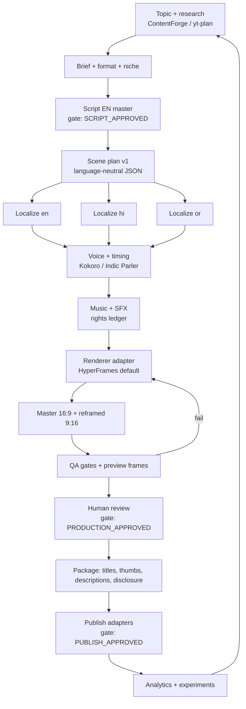
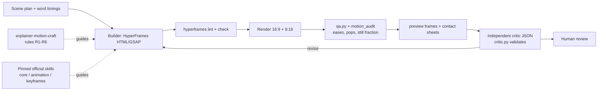

# 05 - Architecture proposal

Principle: **extend contentos, do not replace it.** The existing CLI, ledger, gates, queue, worker and QA stay. New work adds a scene-plan layer, a localization layer, more render templates, richer QA and a skill pack.

## Diagram


## Layers and where they live
| Layer | Responsibility | Status |
|---|---|---|
| Business logic | Pipeline stages, gates, ledger, queue, resume | Exists (`contentos/pipeline.py`, `ledger.py`, `queue.py`) |
| Scene plan | Language-neutral timeline: scenes, beats, visual intents, safe-area roles, asset refs | **New** `contentos/sceneplan/` + JSON Schema |
| Localization | Per-language narration, on-screen text, captions, metadata; glossary, pronunciation dictionary, subtitle validator | **New** `contentos/l10n/` |
| Providers | TTS, STT/alignment, music, image, LLM adapters behind `config/providers.yaml` | Exists; add Indic Parler-TTS, multilingual whisper, ACE-Step |
| Renderers | HyperFrames lane (default), MPT lane (stock b-roll), ffmpeg-only lane (audio visualizers) | HyperFrames + MPT exist; scene-plan compiler **new** |
| QA | ffprobe/ffmpeg checks exist; add captions, safe area, assets, sync, repeat detector, review report | Partly exists (`qa.py`) |
| Packaging/publish | Metadata, thumbnails, upload packages; dry-run publish; later adapters | Package exists; publish DRY_RUN |
| Analytics | Per-video metrics table and experiment records | **New**, after publishing exists |
| Agent layer | Claude Code skill pack, `CLAUDE.md`, hooks that block publishing without approval | **New** (`.claude/skills/factory-*`) |

## Scene plan (core contract)
One JSON file per video, versioned, language-neutral. Renderers consume it; changing renderer does not touch the plan.
```json
{
  "schema": "sceneplan/1",
  "id": "ai-agents-explainer-001",
  "format": "tech-explainer",
  "aspects": ["16:9", "9:16"],
  "scenes": [
    {
      "id": "s1", "chapter": "The problem",
      "intent": "hook",
      "narration_key": "s1.narration",
      "visual": {"template": "stat-card", "params": {"value": "73%", "label_key": "s1.label"}},
      "reframe": {"9:16": {"layout": "graphic-top-caption-bottom"}},
      "assets": ["asset:bg-grid"]
    }
  ],
  "audio": {"music": "asset:music-01", "ducking_db": -14},
  "rights": "assets-rights.json",
  "disclosure": {"ai_realistic": false, "ai_music": false}
}
```
Language files hold `s1.narration`, `s1.label`, glossary entries and metadata for `en`, `hi`, `or`. Timing comes from the generated audio (forced alignment on our own script), not from guessing.

## Manifests and reproducibility
Per project: `manifest.json` records tool versions (hyperframes, ffmpeg, model hashes), input hashes, language, provider chosen and why, stage status and attempts. Masters go to `workspace/projects/<id>/master/`; compressed delivery copies to `.../delivery/`; originals in `.../source/`. Revisions are copied to `.../versions/vN/` before any significant change. A failed stage deletes its own artifact (existing behavior), so resume never trusts partial output.

## Failure states
`QUEUED, RUNNING, RETRYING, BLOCKED_GATE, FAILED_<stage>, NEEDS_HUMAN_REVIEW, QA_PASSED, APPROVED, PACKAGED, PUBLISH_DRY_RUN, PUBLISHED`. Anything the automated checks cannot judge (caption language correctness, visual taste) ends in `NEEDS_HUMAN_REVIEW`, never `QA_PASSED`.

## Reframing 16:9 to 9:16
The plan stores a layout role per scene (`graphic-top-caption-bottom`, `host-full`, `split`). The compiler generates two HyperFrames compositions from one plan; captions use the platform safe zone (top ~14% and bottom ~22% reserved for UI) as configuration, to be confirmed per platform.

## Interfaces
CLI first (`./contentos.sh`), because it already exists. A small status dashboard already exists (`dashboard.py`). No new web UI until the CLI is proven.

## Motion skills and quality gates (added 2026-10-10, see 07 and 08)
Renderer stays HyperFrames. Added around it, not inside the pipeline:

| Piece | Where | Notes |
|---|---|---|
| Pinned upstream skills | `config/upstream-skills.lock.json`, `contentos/upstream_skills.py`, vendored under `.claude/skills/` (gitignored) | `sync`, `verify`, `remove`; tag matches the renderer pin |
| Motion measurements | `contentos/production/motion_audit.py` | Advisory metrics; not yet a blocking gate |
| Critic validation | `contentos/production/critic.py` | Thresholds provisional |
| A/B harness | `scripts/motion_compare.py` | Works on a copy; never writes to the source project |
The existing gates (`SCRIPT_APPROVED`, `PRODUCTION_APPROVED`, `PUBLISH_APPROVED`) are unchanged. Motion checks become blocking only after the builder rules are folded into contentos and thresholds are calibrated (audit 11.3).
