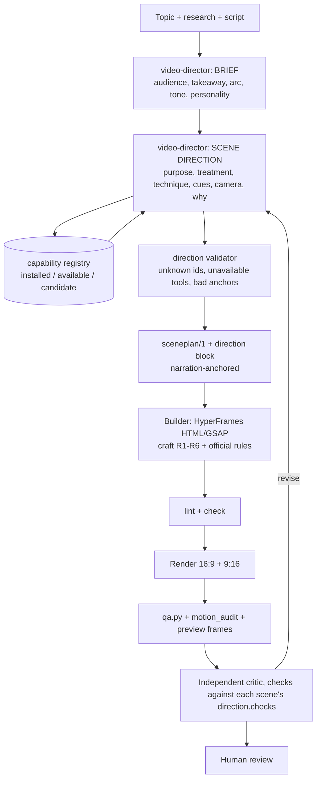

# 10 - Motion Director integration audit (Video Factory v2)

Date: 2026-10-11. Scope: evaluation and architecture design only. Nothing was installed, no production code, global skill, Pilot 001 file, render or experiment was changed. The only file this task adds to `~/git/video-factory` is this document.

## 1. Executive recommendation

1. **Do not install either repository.** Neither is needed to get a coherent creative-director workflow, and installing both would add two overlapping rule sets next to `explainer-motion-craft` (R1-R6) and the pinned official HyperFrames skills.
2. **Motion AI Kit (`motiondivision/ai-kit`): reference only.** It is built for interactive web UI (the Motion library, CSS, React/Vue). Its useful parts are hosted MCP services (docs search, CSS spring generation) or Motion+ paid features (MotionScore audits), and its MotionScore grades real-time rendering cost, which does not exist in a seek-and-capture video pipeline. It also ships **no LICENSE file** (section 2.1), so its text must not be vendored.
3. **LottieFiles `motion-design-skill`: adapt, do not install.** It is MIT-licensed (verified) and its "think like a motion director" method (emotional intent, micro-story, one personality per project, hero-first choreography, counter-motion, troubleshooting list) is genuinely useful for story-driven video. But its hard rules are UI rules, and three of them contradict our house rules (section 4.3). Distil the method into one new reference file inside a new `video-director` skill; do not add the skill itself.
4. **Add exactly one new skill: `video-director`.** It decides *what* each scene is and *why* (story, treatment, technique, cue timing), and writes a small `direction` block into the existing `sceneplan/1` JSON. It does not render and does not replace `explainer-motion-craft`, which keeps deciding *how* motion behaves. HyperFrames stays the only renderer.
5. **Smallest useful next step** (section 11, milestone M1): a `direction` schema extension to `sceneplan/1`, a capability registry that lists only verified tools, and a validator, with tests. No renderer change, no new dependency.

## 2. Verified repository and license findings

Both repos were cloned read-only into a scratch directory outside the project and inspected there. I did not run any installer, MCP server, `npx` command or sign-in.

### 2.1 Motion AI Kit

| Item | Finding |
|---|---|
| Repo / commit | `https://github.com/motiondivision/ai-kit`, HEAD `d1c5c26f424adfd47c112d894e9d424b57338c7e`, 2026-09-25 (merge of PR #3). 10 commits in total history. |
| Contents | `plugins/motion/` (one skill `motion`, ~28 KB of markdown in 5 sub-guides, one agent `motion-reviewer`, a Cursor rule, `mcp.json`) and `packages/motion-ai/` (an npm installer, `src/{cli,install,agents}.ts`). |
| Versions | `packages/motion-ai/package.json` says 14.0.0; the plugin manifest says 1.0.0; the top entry of `CHANGELOG.md` is 7.0.0 (2026-07-28). The three numbers are not consistent; I could not tell which is authoritative. |
| **License** | **No LICENSE file in the working tree and none in any commit** (`git log --all -- LICENSE*` is empty). "MIT" is *declared* in `packages/motion-ai/package.json` and `plugins/motion/.cursor-plugin/plugin.json`. The root `package.json` has no license field and the README has no license section. So MIT is claimed by metadata but no licence text or copyright holder line is shipped. **Flag: do not vendor or redistribute its text** until the owner (Matt Perry / Motion) publishes a LICENSE file or we obtain written confirmation. Reading it for ideas is fine. |
| Installer behavior | `npx motion-ai` copies skills into `<base>/<agent folder>/skills/` where base may be the user's **home directory** (global scope), copies a `.claude/agents` file, and **writes two hosted MCP servers into the agent's config** (`mcp.motion.dev`, `mcp.motion.dev/plus`) via `add-mcp`. Dependencies: `@clack/prompts`, `add-mcp ^2.0.0`; Node >= 18. That conflicts with "no global changes" and with local-first. |
| Not tested | Whether `mcp.motion.dev` is up, and what it returns. I did not contact it. |

Capability split (as documented in the repo's own skill files):

| Capability | Works with no payment and no account? | Works offline? |
|---|---|---|
| Animation best-practices text (`best-practices/*.md`) | Yes (static markdown, "self-contained") | Yes, once the files are on disk |
| Docs / example search (`search-motion-docs`) | Yes, "needs no account" | **No** (hosted MCP) |
| CSS spring / bounce generation (`generate-css-easing`) | Yes | **No** (hosted MCP) |
| MotionScore audit methodology | **No: Motion+** (served by the Motion+ MCP; skill says do not improvise grades) | No |
| Runtime audit `npx motionscore <url> --agent` | Package fetched from npm; runs against a live URL; saving reports needs sign-in | Partly (needs npm fetch and a served page) |
| Source of 450+ examples and Motion UI components | **No: Motion+** (paid; one-time Personal or annual Business) | No |
| Visual transition editor / `save-transition` | **No** (Motion+ / account; also needs an MCP-Apps host, Cursor 2.6+) | No |

What applies to rendered video: almost nothing. The kit targets the `motion` JS library and CSS in a live browser. Its performance doctrine (prefer compositor-only properties, avoid layout thrash) is about frame-by-frame cost for a real-time viewer; our frames are seeked and captured, so jank is not a property of the output. HyperFrames already forbids width/height tweens and CSS transitions for determinism (`rules-index.md` contract). Its CSS `linear()` spring output is a CSS-transition technique, which the HyperFrames contract forbids on animated elements. The one sentence worth borrowing as a principle is in `best-practices/index.md`: "Each animation should show a change of state, a relationship between elements or feedback to an action. Do not add animation only for decoration", which we already state as R4. Reference only.

### 2.2 LottieFiles Motion Design Skill

| Item | Finding |
|---|---|
| Repo / commit | `https://github.com/lottiefiles/motion-design-skill`, HEAD `f9a8a041b85185ee4881b3471d3415e939aac772`, 2026-05-18 (a README edit). No tags. |
| Version | `SKILL.md` frontmatter: `version: "1.0.0"`, `license: MIT`, author LottieFiles. |
| **License** | **MIT, verified**: `LICENSE` file present, "Copyright (c) 2025 LottieFiles", standard MIT text. Redistribution is allowed if the copyright and permission notice are kept. |
| Structure | One `SKILL.md` (~300 lines) plus 16 files: `director/` (8), `patterns/` (4), `reference/` (4); about 44 KB. Content is plain markdown; no scripts, no network, no dependencies. |
| Install | `npx skills add LottieFiles/motion-design-skill` (the skills.sh installer, third party). Frontmatter (`name`, `description`, `license`, `metadata`) matches the format our project-local skills and the pinned HyperFrames skills use, so manual copying under `.claude/skills/` would load. Our supported route for third-party skills is `scripts/upstream_skills.py` with a commit pin and tree SHA-256, not an `npx` installer. |
| Paid / hosted | None. Fully local. |
| Audience | UI: buttons, cards, modals, toggles, hover/press feedback, loading and error states, 60 fps UI budgets, `prefers-reduced-motion`. It says it is "implementation-agnostic", but its tables and examples are UI throughout. |

What I read in full: `SKILL.md`, `director/{decision-framework,narrative-structure,context-adaptation,choreography,emotion-mapping}.md`, `reference/{quality-checklist,troubleshooting}.md`, `patterns/ambient-continuous.md`. What I did **not** open: `director/{core-philosophy,disney-principles,motion-personality}.md`, `patterns/{entrance-exit,state-feedback,multi-element}.md`, `reference/{property-selection,timing-easing-tables}.md`. `SKILL.md` summarizes each of them, and I relied on those summaries for them.

### 2.3 Status of our own capabilities (inspected 2026-10-11)

| Capability | Status | Evidence |
|---|---|---|
| HyperFrames renderer 0.8.114, local `gsap.min.js`, `npx --no-install hyperframes lint/check` | **Installed, working** | `package.json` pin; `01-inventory` doctor PASS; `08` report. I did not re-run `doctor` or the tests today. |
| Pinned official skills `hyperframes-core`, `-animation` (48 atomic rules, 22 blueprints, `animation-map.mjs`), `-keyframes` | **Installed, working** (vendored, gitignored, lock-verified at last report) | `config/upstream-skills.lock.json`, `08` report |
| `explainer-motion-craft` (R1-R6), `explainer-visual-qa` | **Installed, working** (untracked, not yet committed) | `.claude/skills/` |
| Narration-anchored scene plan (`sceneplan/1`, `align`, `resolve`, `storyboard_md`), `preview`, `motion_audit`, `critic` | **Installed, working** | `contentos/production/*`, 66 tests passing at last report |
| Kokoro TTS, whisper.cpp (English only), ffmpeg QA gates | **Installed, working** | `01-inventory`, `qa.py` |
| Builder that turns a plan into HyperFrames HTML | **Gap**: I found no caller of `sceneplan.resolve()` in `contentos/` or `scripts/`; the Pilot HTML was produced outside the shipped package, and `08` states the builder has not been changed. | grep, `08` |
| p5.brush hand-drawn treatment | **Available, not integrated**: verdict KEEP EXPERIMENTAL; owner A/B judgement still pending; no module built | `09`, Project note `p5-brush-evaluation-progress.md` |
| MoneyPrinterTurbo stock-footage lane | **Available, not integrated into scene-level choice** | `01-inventory` |
| "Vibe filters" | **Not found.** The only hits for "vibe" are prose ("gather vibe" questions) in the vendored AGPL OpenMontage `visual-style` skill. There is no implemented filter, dependency or asset. Treat as an unverified future candidate. | grep of the repo |
| Motion Canvas / Remotion | Rejected or deferred in `07` | `07` |

## 3. Capability overlap matrix

Legend: Rec = adopt / adapt / reference / defer / reject. "Where" = rendered video (V), interactive UI (U), both (B).

| Capability | Current implementation | Candidate source | Gap addressed | Offline | Paid | Where | Rec |
|---|---|---|---|---|---|---|---|
| Easing and settle doctrine | R1 (`power3.out`, no overshoot by default) | Lottie easing-by-direction table; Motion kit "no overshoot on serious UI" | None; R1 is already stricter | Yes | No | B | Reference only |
| Reveal timing | R2 narration-cue reveals; `sceneplan` word anchors | Lottie choreography | None for timing source (ours is better: real audio) | Yes | No | V | Keep ours |
| Hero-first staging, one focal point per moment | Implicit | Lottie choreography ("lead with the hero", "one hero per moment") | Not written down as a rule | Yes | No | B | **Adapt** |
| Counter-motion / depth by speed | None | Lottie choreography | Camera + background relationship | Yes | No | B | **Adapt** (sparingly; R3 limits camera) |
| Spatial-origin consistency (entries from one direction) | None | Lottie choreography | Motion-language consistency | Yes | No | B | **Adapt** |
| 1/3 distance rule | R3 (one camera move per scene) | Lottie | Complements R3 for element travel | Yes | No | B | **Adapt** |
| 1/3 simultaneity and stagger <500 ms | None (HyperFrames cap: items x stagger <= ~0.5 s) | Lottie | Stagger is already capped upstream; narration cues must override it | Yes | No | B | Reference only |
| Motion personality (pick one per video) | Not formalized | Lottie archetypes (Playful/Premium/Corporate/Energetic) | Video-level consistency | Yes | No | B | **Adapt** (rename for video; see 5.2) |
| Emotion to motion map | None | Lottie `emotion-mapping` | Mapping tone to easing/pace/path | Yes | No | B | **Adapt** (video-scale durations) |
| Four-act micro-narrative (anticipation, action, reaction, resolution) | None | Lottie `narrative-structure` | Per-reveal shape; scaled to video durations (0.8 s+) | Yes | No | B | **Adapt** |
| Troubleshooting list ("looks robotic / flat / distracting") | `explainer-visual-qa` critic rubric | Lottie `troubleshooting` | Vocabulary for critic feedback | Yes | No | B | **Adapt** (merge into critic rubric as optional hints) |
| Three motion layers incl. mandatory ambient | **Contradicted by R4** | Lottie "Always three layers" (CRITICAL) | None wanted | Yes | No | U | **Reject** for explainers |
| Overshoot / `back` easing for "playful" | R1 forbids unless brief asks | Lottie Playful | Only for explicit playful briefs | Yes | No | B | Reference only |
| Platform adaptation | R5 safe zones, 9:16 unverified | Lottie `context-adaptation` | UI duration modifiers do not carry over; phone readability is a hold-time and size issue | Yes | No | U | Reject (use R5 + phone check) |
| Accessibility | Contrast in `hyperframes check` | Lottie / Motion kit reduced-motion | `prefers-reduced-motion` is not applicable to a fixed MP4; vestibular guidance (avoid big zooms/spin) does apply | Yes | No | B | Adapt the vestibular points only |
| Seek-safe primitives, camera, text, data, SVG draw | Official `hyperframes-animation` rules and blueprints | none needed | None | Yes | No | V | Keep |
| Animation best-practice text for web UI | n/a | Motion kit `best-practices` | Not our domain | Yes | No | U | Reject |
| Docs/example search | n/a | Motion MCP | Not our domain | No | No | U | Reject |
| CSS spring `linear()` generator | `spring-pop-entrance` rule | Motion MCP | CSS transitions are forbidden in compositions; a spring curve could be sampled locally if ever needed | No (hosted) | No | U | Reject (write our own if ever needed) |
| MotionScore performance audit | `motion_audit.py` (pops, ease inventory), `animation-map.mjs` | Motion+ | Measures real-time render cost, irrelevant to seeked capture | No | **Yes** (Motion+) | U | Reject |
| Transition preview / editor | `contentos preview` contact sheets | Motion+ editor | UI-only | No | **Yes** | U | Reject |
| Hand-drawn texture | Native SVG draw-on (control) | p5.brush (experimental) | Texture only; owner decision pending | Yes | No | V | Defer to owner |
| Stock footage | MPT lane | existing | Scene-level selection rules | Partly | No | V | Wire into registry |
| Vibe filters | None | none verified | Unknown | ? | ? | ? | Defer (unverified) |
| Story/treatment decision before renderer choice | **None** | new `video-director` | The actual gap | Yes | No | V | **Build** |

## 4. Adopt, adapt, defer, reject

### 4.1 Adopt
Nothing from either repo verbatim.

### 4.2 Adapt (into one file, `video-director/references/motion-intent.md`, about 150 lines, paraphrased with an attribution line to LottieFiles MIT)
- Three questions before technique: what should the viewer feel, what is the micro-story, how do we make it believable.
- One personality per video, chosen from the brief's tone (section 5.2), applied to every scene.
- Hero-first staging, spatial-origin consistency, counter-motion at low amplitude, depth by relative speed.
- Four-act shape for any reveal over about 0.8 s, with explicit permission to skip anticipation and reaction.
- The troubleshooting vocabulary as optional hints for the critic.
- Vestibular cautions (large zooms, spin, rapid direction changes) as a hard limit on camera moves.
- Emotion to motion table, with durations rescaled for video (see 5.2) rather than UI milliseconds.

Copying more than a short table verbatim requires keeping the LottieFiles MIT notice next to the file. Paraphrase plus a source line avoids that.

### 4.3 Where Lottie contradicts our rules (the director must follow ours)
| Lottie says | House rule | Resolution |
|---|---|---|
| "Always three motion layers: primary + secondary + ambient" (CRITICAL) | R4: no breathing, no `repeat:-1`, stillness beats fake life | Ours wins. Ambient defaults to `none`; allowed only if the brief asks and the loop is finite and seek-safe |
| Stagger total must stay under 500 ms; "mobile 0.8x durations" | R2: reveal when the word is spoken; R6/phone readability needs longer holds | Narration timing overrides stagger budgets; never shorten holds for phones |
| Playful = `ease-out-back` with 10-30% overshoot | R1: no `back/elastic/bounce` unless brief asks | Overshoot allowed only when `brief.personality = "playful"` |

### 4.4 Defer
- p5.brush: stays an optional scene treatment, blocked until the owner judges the A/B and approves the module (decisions already recorded in `09` section 12).
- Vibe filters: no verified implementation; do not reference them in the registry as available.
- The rest of the official HyperFrames skill family listed as deferred in `07` section 11.2.

### 4.5 Reject
Motion AI Kit installation, its MCP servers, MotionScore, Motion+ features, the CSS spring tool, and the Lottie skill as an installed skill.

## 5. Proposed topic-to-storyboard architecture



Order matters: story first (steps 1-4 below), then treatment, then technique, then renderer. The director never picks a technique before it has written the scene's takeaway.

### 5.1 What `video-director` decides, in order (maps to your list of 11 questions)
1. **Audience and understanding.** Who watches (viewer level, phone, silent autoplay or sound), and the one sentence they should be able to say afterwards.
2. **Message, arc and hook.** Central message; arc from the script's own structure (hook, setup, mechanism, example, contrast, recap, CTA). The hook's first 2 s must carry the takeaway visually.
3. **Tone and visual language.** One `tone` and one `personality` for the whole video.
4. **Storyboard.** One scene per idea; each scene has a purpose and a takeaway of at most about 12 words. Merge scenes with no distinct takeaway.
5. **Treatment per scene.** text, diagram, stat, ui-demo, metaphor, footage, handdrawn or static image. Chosen by what the viewer must understand, not by what is available. If the idea needs movement to be understood (a process, a flow, a before/after), animate; if not, hold.
6. **Technique per scene.** One or two registry ids (section 8), each with a one-line `why`. No technique without a reason; no animation just because it exists.
7. **Capability check.** Every id must exist in the registry with status `installed`, or `available` only when the video brief opts in. Otherwise use the scene's `fallback`.
8. **Sufficiency.** If neither a technique nor a fallback can deliver the takeaway (for example footage that is not licensed), the director says so, downgrades to text or a static image, and sets the scene to needs-human-review. It never invents a tool or asset.
9. **Sync.** Each reveal is a `cue` anchored to a narration phrase or word index, resolved to time by `sceneplan.resolve()`. Sound cues (stings, ducking points) are also cues, only if the audio lane supports them; otherwise none.
10. **Aspect ratios.** One direction block feeds both formats. Per-aspect overrides only for layout role (see `reframe` in the 05 architecture), never a second story.
11. **Verification.** Each scene lists the checks that apply (phone legibility, cue-sync tolerance, no overshoot, safe zone); the critic grades the real render against them.

### 5.2 Personality for video (adapted, one per video)
| Personality | Use when | Entrance ease | Overshoot | Camera | Typical reveal length |
|---|---|---|---|---|---|
| `calm-precise` (default for explainers) | Technical, finance, how-it-works | `power3.out` | 0 | Hold, rare slow push | 0.4-0.7 s |
| `premium` | Brand, product story | `power2.inOut` / `power3.out` | 0 | Slow, long holds | 0.6-1.0 s |
| `energetic` | Hooks, shorts, news | `expo.out` / `power4.out` | 0 (snap, no bounce) | Punch-ins allowed | 0.2-0.4 s |
| `playful` | Kids, light brand | `back.out(1.2)` | up to ~10% | Gentle | 0.3-0.5 s |

The durations above are my adaptation for video, not from either repo; the first row follows R1-R4. They are starting points to calibrate in M4, not tested thresholds.

## 6. Proposed scene schema and example

Principle: **extend `sceneplan/1` additively.** `sceneplan.resolve()` already copies unknown scene keys through (`{**sc, "i0": i}`), so an optional `direction` object does not break existing plans, tests or Pilot 001. Free-text `visual` stays as the human-readable storyboard line. Add a top-level optional `brief`. Version string becomes `sceneplan/1` with `direction` present, or `sceneplan/2` if you prefer an explicit bump (open question, section 12).

```jsonc
// top level (optional)
"brief": {
  "audience": "developers new to AI agents; watching on phone, often muted",
  "takeaway": "The model only asks for a tool call; your app runs it.",
  "arc": ["hook","setup","mechanism","example","recap","cta"],
  "tone": "clear, slightly surprising, never hype",
  "personality": "calm-precise",          // one of the table in 5.2
  "renderer": "hyperframes",              // default; per-scene override only via direction.technique ids
  "opt_in": []                            // e.g. ["handdrawn"] only after owner approval
}

// per scene (optional)
"direction": {
  "purpose": "mechanism",                  // hook|setup|mechanism|example|contrast|recap|cta
  "takeaway": "The tool call is just text; your app executes it.",
  "treatment": "diagram",                  // text|diagram|stat|ui-demo|metaphor|footage|handdrawn|static
  "focal": "tool_use JSON block",          // the one thing to watch
  "technique": ["hf.rule:svg-path-draw", "hf.rule:asr-keyword-glow"],
  "why": "A packet travelling MODEL -> APP -> SYSTEM shows who acts; keyword glow ties each node to its spoken word.",
  "motion": { "primary": "packet path draw-on", "secondary": "node highlight on word", "ambient": "none" },
  "cues": [ { "at": "in a typical setup", "do": "YOUR APP and EXTERNAL SYSTEM nodes enter" },
            { "at": "api", "do": "API chip lights" } ],
  "camera": "pan-to:external-system",      // hold | push | pull-back | pan-to:<element id>; at most one move per scene (R3)
  "exit": "dissolve",
  "text_zone": "caption-band",             // keeps content out of the caption/safe band (R5)
  "assets": [],                            // [{ref, source, license}] required whenever a non-generated asset is used
  "fallback": "hf.native:text-card",
  "checks": ["phone-legible", "cue-sync<=2f", "no-overshoot", "safe-zone"]
}
```

Rules enforced by the validator (a small Python module beside `sceneplan.py`, M1):
- `technique` and `fallback` ids must exist in `config/capabilities.json`; `status` must be `installed`, or `available` with the id listed in `brief.opt_in`; `candidate` ids are rejected.
- `purpose`, `treatment`, `personality` and `camera` are enums; `motion.ambient` defaults to `none`; any other value requires `brief.personality` to allow it and a finite-loop note.
- `cues[].at` must resolve through `_find_phrase` or be a valid word index, in increasing order within the scene.
- `why` is required whenever `technique` is not the treatment's default (for example a camera move on a `text` scene, or any `handdrawn`).
- `assets[]` entries need `license`; anything with `license: unknown` blocks the scene.
- Overshoot easings only when `personality = playful` (reuses `motion_audit.ease_inventory`).

Fields deliberately **not** added: per-property durations and easings (the builder and R1-R6 own those), mood boards, colour palettes (already in the design/brand layer), per-frame keyframes.

## 7. Skill activation and precedence

New file layout (one new skill, nothing from Lottie or Motion kit installed):
```
.claude/skills/video-director/SKILL.md                 # workflow in section 5.1, <= ~120 lines
.claude/skills/video-director/references/motion-intent.md   # adapted Lottie method (4.2), with source line
.claude/skills/video-director/references/capabilities.md    # human-readable view of config/capabilities.json
config/capabilities.json                               # machine-readable registry (section 8.1)
```

**Activation by stage**
| Stage | Skills loaded | Never loaded |
|---|---|---|
| Storyboard / direction | `video-director` (+ its two references) | animation rule files (not needed to decide story) |
| Build (HTML/GSAP) | `hyperframes-core`, `explainer-motion-craft`, 2-4 rules from `hyperframes-animation`, `hyperframes-keyframes` if the scene has a camera move | `video-director` references |
| QA | `explainer-visual-qa` | the others |

**Precedence (higher wins; a lower item may only fill gaps, never override)**
1. The video brief and owner decisions (including `brief.opt_in`).
2. `hyperframes-core`: determinism and seek-safety are hard constraints.
3. `explainer-motion-craft` R1-R6 (house rules; includes measured Pilot 001 evidence).
4. `video-director` (decides story, treatment, which technique ids).
5. Official `hyperframes-animation` and `-keyframes` (mechanisms, rule contracts).
6. `motion-intent.md` (advisory; applies only where R1-R6 are silent).
7. `explainer-visual-qa` runs after render and may send work back to any earlier stage; it does not change rules.

If two rules conflict, the director records the conflict in the scene's `why` and follows the higher item. The skill description fields should be written so that `video-director` triggers on storyboard/brief work and `explainer-motion-craft` on authoring/revising animation, to avoid both loading for the same task.

## 8. Renderer-selection decision tree

HyperFrames is the default and the only renderer that produces the MP4. "Technique" means a scene-level choice of *how the scene's frames are made inside or alongside a HyperFrames composition*.

### 8.1 Capability registry (`config/capabilities.json`, proposed)
Each entry: `id`, `status` (`installed` / `available` / `candidate`), `kind` (rule, treatment, asset-lane, qa), `offline` (bool), `paid` (bool), `applies` (`video` / `ui` / `both`), `requires` (files/commands the validator can check exist), `notes`. Seed content for M1, drawn only from section 2.3:

| Id | Status | Basis |
|---|---|---|
| `hf.native:text-card`, `hf.native:svg-diagram`, `hf.native:stat-card` | installed | HyperFrames + local GSAP |
| `hf.rule:<name>` for each of the 48 files in `hyperframes-animation/rules/` | installed (registry generated by scanning the directory, so it cannot drift) | vendored skill, lock-verified |
| `hf.blueprint:<id>` for the 22 blueprints | installed | `blueprints-index.md` |
| `craft:R1`..`craft:R6` | installed | `explainer-motion-craft` |
| `lane:mpt-stock` | available (not wired per scene; needs licensed footage and the MPT API on :8081) | `01-inventory` |
| `treatment:handdrawn-p5brush` | candidate (experimental; blocked on owner decision) | `09` |
| `treatment:vibe-filter` | **not listed** (nothing verified) | grep |

### 8.2 Decision tree (per scene)
```
1. What must the viewer understand? (direction.takeaway)  -> write it first.
2. Does understanding require seeing change over time?
     no  -> static or held treatment (text/stat/diagram at rest); no motion beyond a cue-timed reveal.
     yes -> go to 3.
3. Treatment:
     words / claim / definition      -> hf.native:text-card + R2 cue reveals (asr-keyword-glow only if a keyword is the point)
     process / flow / architecture   -> hf.native:svg-diagram + svg-path-draw, packet motion; one camera move max (R3)
     number / comparison / trend     -> hf.native:stat-card + counting / stat-bars-and-fills
     UI or product behaviour         -> a hyperframes blueprint (cursor/ui demo family) using real or mocked screens
     real-world scene needed         -> lane:mpt-stock ONLY if licensed assets exist; else static image or diagram, flagged for review
     hand-drawn look requested       -> treatment:handdrawn-p5brush ONLY if status is no longer "candidate" AND brief.opt_in has it;
                                         otherwise native SVG draw-on (the 09 control)
4. Technique budget: 1 primary action, at most 1 secondary, ambient none. More requires a written reason.
5. Camera: hold unless the camera move itself explains something (e.g. pull-back to reveal the loop). One move per scene, start from the previous end state.
6. Sufficiency check: every id in registry and allowed? If not -> use fallback; if no fallback delivers the takeaway -> text/static + NEEDS_HUMAN_REVIEW.
7. Aspect: same direction for 16:9 and 9:16; only layout role differs; verify phone legibility on the render.
```
Motion AI Kit appears nowhere in this tree on purpose: it targets interactive UI.

## 9. Offline and paid-service boundaries

- **Default path is fully local and free**: HyperFrames, GSAP (local file), Kokoro, whisper.cpp, ffmpeg, Python 3 and the registry/validator. The director and validator add no network call and no dependency.
- Existing rule stands: no render-time network (fonts and GSAP local; upstream examples that load a CDN are not copied).
- Motion AI Kit: the docs search and spring tools need hosted MCP at `mcp.motion.dev`; MotionScore, example/UI source and the transition editor need a paid Motion+ account. **None are used.** No sign-in or account is required or requested.
- Any new capability must declare `offline` and `paid` in the registry. A `paid: true` entry is not selectable without an explicit `brief.opt_in` and the existing `allow_paid: false` policy being changed by the owner.
- The one network step in this plan is on-demand and manual: fetching an upstream skill to refresh a pinned reference, via the existing `upstream_skills.py`, never from inside a render.

## 10. Security and dependency risks

| Risk | Detail | Mitigation |
|---|---|---|
| `npx motion-ai` writes to agent config and possibly the home directory | Installs skills with `base = homedir()` in global scope, copies agents, adds two remote MCP servers | Do not run. This also keeps "no global skill changes" intact |
| Remote MCP as an instruction source | `mcp.motion.dev` serves tool results and (for audits) methodology text at runtime; a third party can change what the agent is told | Not connected. If ever tried, treat results as data, sandbox, and keep it out of the production session |
| Unclear licence (Motion kit) | MIT declared in metadata, no LICENSE file in any commit | No vendoring or redistribution; ask the owner to add a LICENSE if reuse is ever wanted |
| Skill-text injection / drift | Imported skills are instructions the agent follows | Pin by commit and tree hash through `upstream_skills.py`; read before enabling; do not auto-load unreviewed text |
| Contradictory rules | Two skills teaching opposite rules (section 4.3) lead to inconsistent output | One registry, one precedence order (section 7), Lottie content adapted not installed |
| Third-party installer for Lottie (`skills.sh`) | Another package manager with its own supply chain | Avoid; if the full text is ever wanted, add it to `upstream-skills.lock.json` at `f9a8a041…` and place it outside the auto-loaded skills directory |
| Director inventing tools | A model can name a plausible but nonexistent capability | Validator rejects any id not in the generated registry; status gates enforced in code |
| Licensed assets | Footage/music with unknown terms | `assets[].license` required; `unknown` blocks the scene (consistent with `04-licensing-matrix`) |
| OpenMontage is AGPL-3.0 | `visual-style` text lives there | Architecture reference only; do not copy |
| New code touching Pilot 001 | A new validator might be run against it | Validator is read-only and optional; Pilot 001 has no `direction` block and stays valid |

## 11. Minimal implementation plan with testable milestones

Nothing below is started. Each milestone is independent and reversible; all are additive.

| # | Milestone | Deliverable | Test / exit criterion |
|---|---|---|---|
| **M1** | Schema + registry + validator (smallest useful step) | `config/capabilities.json` (generated from the rules directory plus a short hand-written part), `contentos/production/direction.py` (`validate(plan, registry)`), `tests/test_direction.py` | Tests: unknown id rejected; `candidate` rejected; `available` needs `opt_in`; bad cue anchor rejected; ambient != none rejected unless allowed; overshoot ease rejected unless playful; **Pilot 001's existing `scene-plan.json` still passes** (backward compatible); `pytest tests` stays green |
| **M2** | Dry-run direction on a new topic | `video-director` skill (workflow only) and `motion-intent.md`; direction written for one script, **no render** | A second human or the critic can read the storyboard and say which technique each scene uses and why; validator passes; `storyboard_md` shows treatment and technique columns |
| **M3** | Builder consumption, narrow | Builder reads `direction.cues`, `camera`, `text_zone`; falls back to the free-text `visual` when absent | One new short video renders in 16:9 and 9:16; `lint`, `check`, `motion_audit` (0 overshoot, pops explained), `preview` sheets reviewed; Pilot 001 untouched (tree hash unchanged) |
| **M4** | A/B the director | `scripts/motion_compare.py` on a copy: direction-driven build vs R1-R6-only build | Counted metrics (dead zones during speech, pops, overshoot) plus a human judgement on frames; critic thresholds calibrated on 3-5 reviewed videos |
| **M5** | Optional treatments | p5.brush module only if the owner approves `09`; stock lane wiring only with licensed assets | Their own tests (spec determinism, fallback to SVG, disabled by default) |

Rollback: delete `video-director/`, `config/capabilities.json`, `direction.py` and its test. Plans with a `direction` block still resolve because unknown keys pass through `resolve()`.

## 12. Exact files examined and any files changed

**Changed in `~/git/video-factory`:** only this new file, `docs/factory-v2/10-motion-director-integration-audit.md`. Nothing was modified, reset, stashed, deleted or formatted.

**Initial and final Git status:** branch `main`, HEAD `cfc0ea3`; 17 entries at the start (`M .gitignore`, `M contentos/cli.py`, and 15 untracked: `.claude/`, `config/upstream-skills.lock.json`, `contentos/production/{align,critic,motion_audit,preview,sceneplan}.py`, `contentos/upstream_skills.py`, `docs/factory-v2/`, `scripts/{motion_compare,upstream_skills}.py`, `tests/test_{align_sceneplan,critic,motion_audit,upstream_skills}.py`). Hash of `git status --porcelain` at start: `a337a7c9a090e26b2e696e7fb6b76f33`. After this report is added the only difference is the new document inside the already-untracked `docs/factory-v2/`. Pilot 001 (`workspace/projects/pilot-001-agent-tool-use`) and `workspace/experiments/*` were read, not written.

**Read in `~/git/video-factory`:** `docs/factory-v2/{05-architecture,08-motion-skills-implementation-report}.md` in full; `01-inventory.md` (parts), `07-motion-graphics-skills-audit.md` (section list and 11.x), `09-p5-brush-evaluation.md` (sections 1, 4, 11, 12, headings); `.claude/skills/explainer-motion-craft/SKILL.md`, `.claude/skills/explainer-visual-qa/SKILL.md`, `.claude/skills/hyperframes-animation/{rules-index,blueprints-index}.md` and the rules directory listing; `config/upstream-skills.lock.json`; `contentos/production/sceneplan.py`; the listing of `contentos/`, `contentos/production/`, `contentos/templates/`, `contentos/adapters/v1/`; first lines of `contentos/adapters/v1/scene-derivation.mjs`; `package.json`; `workspace/projects/pilot-001-agent-tool-use/src/scene-plan.json`; `vendor/OpenMontage/.claude/skills/visual-style/SKILL.md` (head) and a repo-wide grep for "vibe", "lottie", "motiondivision", "sceneplan". The Project note `claude/p5-brush-evaluation-progress.md` was also read.

**Read from the two repositories (scratch clones, outside the project):** Motion AI Kit: `README.md`, `package.json`, `plugins/motion/{README.md,mcp.json,.cursor-plugin/plugin.json,agents/motion-reviewer.md}`, `plugins/motion/skills/motion/{SKILL.md, best-practices/index.md, best-practices/css-or-motion.md, css-spring/index.md, performance-audit/index.md, transition-preview/index.md, codex/index.md}`, `packages/motion-ai/{package.json,scripts/sync-content.mjs}`, first 80 lines of `src/install.ts`, head of `CHANGELOG.md`, history check for a LICENSE file. Not opened: `best-practices/{react,vue,motion,base-ui}.md`, `src/cli.ts`, `src/agents.ts`, `rules/motion.mdc`. LottieFiles: `LICENSE`, `README.md`, `skills/motion-design/SKILL.md` and the nine files named in 2.2.

## Limitations (not guessed)
- I did not contact `mcp.motion.dev` or `motionscore`, so I cannot say whether they are online or what they return.
- I did not re-run `./contentos.sh doctor`, `pytest`, `hyperframes lint/check`, or `upstream_skills.py verify` in this session; the "installed, working" statuses rely on the 2026-10-10 reports plus file presence.
- The personality table values in 5.2 are my proposals, not tested thresholds.
- I could not find where a plan becomes HyperFrames HTML in the shipped package; M3 should start by locating or creating that entry point.
- Whether Claude Code on the Mac loads the project-scoped skills is still untested (carry-over from `08`).

## Open questions for the owner
1. Keep `sceneplan/1` with an optional `direction` block (recommended), or bump to `sceneplan/2`?
2. Approve M1 as the next step?
3. Do you want me to ask Motion for a LICENSE file, or just leave the kit as reference?
4. p5.brush A/B verdict and the other carry-overs from `09` section 12 are still pending.

Sources (accessed 2026-10-11): https://github.com/motiondivision/ai-kit (`d1c5c26`) · https://github.com/LottieFiles/motion-design-skill (`f9a8a04`, MIT)

## Implementation progress (added 2026-10-11)
M1 is implemented; see `11-motion-director-m1-report.md`. The findings above are unchanged. Differences from the plan in sections 6 and 8: the registry lives in `config/capabilities.json` (93 entries: 88 installed, 2 available, 1 candidate, 2 unavailable); `hf.native:text-card/svg-diagram/stat-card` became one verified id, `hf.native:html-svg-css`, because no card templates exist; `lane:mpt-stock` is a whole-video lane and cannot be a scene technique; the `direction` block validates against `sceneplan/1` without a version bump (the resolver passes unknown scene keys through, tested). M2 and later are not started.
