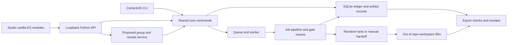

# 04 / Domain model and architecture

**Research date:** 2026-11-24. **Scope:** logical model and persistence boundaries, no migrations. **Evidence / sources:** `contentos/ledger.py`, `contentos/queue.py`, `contentos/ui_state.py`, `contentos/videojob.py`, `docs/STORAGE.md`, [00](00-RECONCILIATION.md). **Verified:** jobs, stage rows, render attestations and artifact files exist; groups and agent tasks below are proposals. Preserve CLI compatibility and import legacy jobs read-only before introducing group writes.

| Entity | Fields and relationship | Lifecycle, ownership and persistence | Today |
|---|---|---|---|
| Workspace | `id`, label, root references; owns all entities; optional future membership | Local configured roots plus proposed stable logical ID; never persist machine-specific roots in derived specs | Roots only |
| Campaign | `id`, workspace, defaults revision, brand refs, episode order | Draft/active/archived; immutable defaults revisions with workspace ownership and append-only history | Proposed |
| Batch | `id`, workspace, row keys, import digest, submit receipts | Draft/validated/submitting/partial/submitted; immutable submitted rows; archive grouping without deleting jobs | Proposed |
| VideoJob | `contentId`, workspace, optional campaign+revision / batch+row, effective spec revision, lane | Draft through export; Workspace-owned; canonical persisted job/spec; version resolved at submission | Job folder, spec and read model |
| CreativeBrief | `id`, revision, job/campaign, objective, audience, inputs and rights | Editable drafts, cloned at submit; save as proposed versioned file/record, not duplicated in approval | Spec fields/agent documents |
| Asset | `id`, hash, kind, origin, rights, file ref, size, availability | Import/inspect/ready/missing/blocked; workspace owned; never silently substitute bytes; version by digest | Local index and partial staged adapter |
| WorkflowPlan | `id`, revision, ordered requirements, lane, blockers, manual steps | Derived from input + registry version; freeze accepted plan for reproducibility, rerun readiness before actions | Selector/scene plan, not a common Studio plan |
| AgentTask | `id`, job/revision, purpose, source, actor label, status, outputs | Requested/running/returned/failed only with real receipt; local human handoff initially; cannot award grants | Manual skill and CLI work, proposed persistence |
| ProductionRun | `runId`, job/spec revision, stages, locks, attempts, evidence | Append attempts; workspace/job scope; core ledger authoritative; transient worker state not an approval | Stage and render ledger |
| Approval | job, gate, subject digest, subject revision, attribution kind/channel, optional authenticated principal, time, decision | Append-only proposed supersession/attribution; atomic grant bound to sealed subject; separate private principal | Digest and gate columns; semantics incomplete |
| Artifact | `id`, job, run, role, media ref, digest, provenance | Recorded/not present/verified/invalid; immutable identity independent of filename; stream only through authorized named artifact | Manifest, files and render ledger |
| Export | `id`, job, attested MP4 digest, intended destination, sidecar, receipt | Preflight/exported/conflict/failed; write sidecar last and reconcile partial output; no publishing | Storage export and sidecar |

Campaign resolution: explicit episode value > selected immutable campaign defaults > ordinary job default. Absence and explicit None differ. Persist effective spec and source of each resolved field. Rebase only selected drafts with a displayed diff; later edit of reviewed work creates new revision and invalidates grant eligibility. Batch membership does not authorize running, reviewing or exporting. Dedupe intent keys within workspace/operation, scoped to immutable revision and canonical payload; same key with different payload conflicts. File and ledger updates need reconciliation if they cannot commit together. No database redesign to deliver first read-only slice.

Example episode `ep04` pinned to campaign `r3`; illustrative revision IDs, not API output:

| Field | Effective value | Source layer and revision | Mode | If campaign r4 changes it |
|---|---|---|---|---|
| `language` | `hi` | episode `ep04:r2` | overridden | no effect on rebase unless override is removed |
| `voice` | `null` | episode `ep04:r2` | cleared | stays cleared; validation blocks if required |
| `brand.logo` | `asset:sha256:<digest>` | campaign `series:r3` | inherited | selected draft shows old/new digest in rebase; existing episode stays pinned |
| `target.aspect` | `9:16` | job defaults `target-profile:v1` | defaulted | resolution remains pinned; recompute only on explicit rebase against named defaults |

Record the canonical resolved configuration and per-field source revisions. Distinguish omission from explicit clear; required clears become blockers rather than fall through. Asset replacement creates a new digest and a new defaults revision, never mutates a pinned reference. Logical archive hides an asset from new selections while retaining bytes for referenced work. Missing/corrupt/physically removed bytes mark dependent revisions blocked; restore identical bytes or fork and re-review with a new asset. Do not auto-prune references under review, queued, in runs, or in attested history. Rebase creates new draft lineage, never edits an approved revision or grants.

**Assumptions:** one local workspace now; design IDs for ownership without adding permissions UI. **Open questions:** retain imported manifests as versioned files versus tables; surgical reuse of current ledger APIs after PF-05/PF-02. [API](08-API-GAP-ANALYSIS.md).
