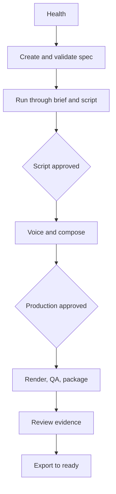

# Product and user journeys

## Product

Video Factory Creator Studio is a local workbench for one owner who reviews videos that they or an agent have prepared. Its job is to answer: what needs attention before this video can move safely to the next stage?

The existing CLI remains the expert and scripting interface. The Studio adds the review, approval, health, and progress surfaces that are awkward in a terminal. It does not add publishing, paid providers, cancellation, or a second pipeline.

## Primary journey

1. Check Health. If FFmpeg, Kokoro, whisper.cpp, or the workspace is not usable, stop and show the fix.
2. Create a Track A spec in the workspace and validate it.
3. Run it. The run stops when `SCRIPT_APPROVED` is missing.
4. Read the title and script, then approve that exact digest.
5. Resume. Voice and compose run, then the job waits for `PRODUCTION_APPROVED`.
6. Inspect the composition, preview frames, and QA evidence, then approve that exact digest.
7. Resume through render, QA, and package.
8. Export the validated file to the publishing library. Stop before publish.

## Ranked journeys

| Rank | Journey | Why it leads |
|---|---|---|
| 1 | Review quality evidence | This is where a bad video would otherwise ship |
| 2 | Approve the two gates | A wrong grant is hard to undo because approvals are append-only |
| 3 | Diagnose a failed or blocked stage | The current CLI hides this in text and short ledger errors |
| 4 | Run and resume one job | Frequent, but the CLI already does it |
| 5 | Check Health | Infrequent, and currently it blocks the whole machine |
| 6 | Create and validate | Required, and no validate command exists yet |
| 7 | Queue | Useful after one job is trustworthy |
| 8 | Export | Small, but it writes outside the workspace |

Track B registration, Remotion, MoneyPrinterTurbo, research, competitor analysis, Jev, and ContentForge stay outside this journey until their own evidence exists.

## States the owner must be able to tell apart

- Draft: a spec exists and no job folder has been opened.
- Running: `.run.lock` is held, even when the ledger row is older than 600 seconds.
- Blocked: the latest ledger row is `BLOCKED`. This is a waiting gate, not a failure.
- Failed: the latest row is `FAIL`, with class `transient` or `output`.
- Stale: a `RUNNING` row is older than 600 seconds and the lock is free.
- Approved: the current script or production digest matches the stored grant.
- Rendered: `video.mp4` exists. This does not mean QA passed.
- Checked: pipeline QA or a named manual check has a result. Absent checks say "not run".
- Exported: the publishing sidecar exists. This does not mean published.

## Non-goals for the first release

No Publish control, no `--allow-paid`, no Cancel button, no recorded Reject, no ContentForge inbox, and no remote login. A VPS deployment is a later security design, not a change to the bind address.
