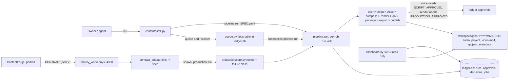

# Current architecture (Phase 1, 2026-10-19)

Evidence: source read at `main` dc80b47, re-checked on the Mac at eab249a on 2026-10-20 (tree clean apart from these docs; the Milestone 2 feature hooks are now committed). Phase 1-3 text is from reading code; Phase 4 ran commands (doctor, status, pytest, node tests, a read-only dashboard probe); see "Limits".

## Shape
Local-first Python CLI (`./contentos.sh` -> `contentos/cli.py`, 253 lines) with a stage engine (`contentos/pipeline.py`, 501 lines) and a small read-only dashboard. No application server other than the dashboard and the ContentForge exchange worker.

Not shown by the code path: `publish` is a dry run (`config/youtube.yaml` publish disabled; upload adapter "not implemented yet", `s_publish` always blocks).

## Stages (`STAGES` in pipeline.py)
brief, script, voice, compose, render, qa, package, export, publish. Resume is by artifact existence. Stage rows go to the ledger `runs` table (run_id, content_id, stage, provider, status, start, end, error, retries).

## Two production tracks
- Track A: automated, spec YAML -> `pipeline run`; one scene per script line. Builder is `pipeline.s_compose`; Milestone 2 adds opt-in `contentos/features/*` hooks (audio_bed, captions_hook, extra_gates, scene_plan, style_card, visual_layer, via `registry.py`).
- Track B: director-led, agent-authored HyperFrames composition; enters the factory through `./contentos.sh job register PATH --track B` (writes only `manifest.json`). The builder does not consume scene plans in the default path.

## Job contracts and render lanes
There is no `VideoFactoryJobRequest` symbol or schema in this repository. The external ContentForge boundary is the JavaScript adapter for `contractVersion: video-factory.contract.v1` in `contentos/adapters/v1/contract_adapter.mjs`; it converts a `CONTRACT.json` object into a Track A spec. The UI should create and validate the native Track A YAML shape rather than adopt this parked exchange contract.

`pipeline.RENDER_LANES` accepts `hyperframes`, `remotion`, and `mpt`. HyperFrames is the default operational path. Remotion is registered and reachable in code, while the operator contract in `AGENTS.md` documents only HyperFrames and MPT; Remotion and MPT have not been operationally verified in this discovery. The first UI slice therefore exposes HyperFrames only.

## State stores (from code and prior notes)
Ledger SQLite (`runs`, `approvals`, `decisions`, `jobs`), per-job folder files (manifest, `qa.json`, `content.json`), ContentForge worker's in-memory/file job map. Approvals are bound to content digests (commit b3dabdb). The UI must read these, not create a fourth.

## Quality tooling (standalone, not called by the pipeline unless noted)
`qa.run_qa` (nine ffprobe/ffmpeg checks, in pipeline), `finalcheck` (export), `production/visual_gate.py`, `critic.py` (validates an independent critic's JSON), `preview`/`sheet.py` contact sheets, `intelligence/visual.py` (Rule A/B), `cue_audibility.py`, `checkpoint.py`. Milestone 1 notes record that several gates have known gaps.

## Existing UI
`contentos/dashboard.py` (124 lines): stdlib `ThreadingHTTPServer` on 127.0.0.1:4310, read-only. `GET /` serves `dashboard.html` (70 lines, vanilla JS, light/dark CSS); `GET /api/state` returns jobs with per-stage status, QA, approvals, publish recommendation, provider health, Jev status, queue rows, recent decisions; `GET /media/<id>/<file>` serves a whitelist (video.mp4, qa.json, script.md, metadata.yaml, publish-result.json, script-lint.json) with Range support and ID validation. No write endpoints, no logs, no create/run/approve, no SSE. Status STALE is derived after 600 s of RUNNING.

## Limits (updated 2026-10-20)
Phases 1-3 were written from a Linux VM without the venv. On the Mac the following were then verified: `doctor` output, `status`, node tests 44/44, the pytest result (see test-inventory.md), and that the dashboard answers `/api/state` (200, 51 KB, 44 jobs), returns 501 to POST and 404 to a traversal path. Not done: a real render (arm64 ffmpeg and whisper-cli are absent right now), UI screenshots (browser daemon would not start), `--help` of every subcommand beyond the top level.
