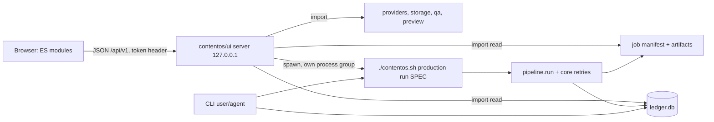

# UI architecture (Phase 7)

## Decision summary
1. Grow the existing `contentos/dashboard.py` into a versioned JSON API on the stdlib `ThreadingHTTPServer`. No new Python dependency: the venv has pyyaml, numpy, pytest and no web framework (checked by import).
2. Front end: plain ES modules, no build step, served from `contentos/ui/`. No React/Vite: the repo has no frontend toolchain, the user is one local owner, and a build step would add a second thing to pin and break.
3. Runs execute in a subprocess, never in the server process. The ledger and job manifest stay the only state; the UI derives status from them.
4. Reuse, do not rewrite: `pipeline.run`, `production.core.run_until_blocked_or_done`, `ledger`, `storage`, `qa`, `providers`, `queue`. The server imports them and spawns `./contentos.sh` for work.
5. Anything the CLI cannot do yet is added to the Python core first (validate, structured doctor, per-stage logs, cancel), with CLI flags, and the API calls the same function.

## Components

The CLI and the UI write to the same ledger; the per-job `.run.lock` already arbitrates between them.

## Why subprocess, and which one
Options considered:
- In-process `pipeline.run` on a server thread: no isolation; a Chrome or ffmpeg hang freezes request handling; process-wide env (`ENV`, `HYPERFRAMES_PYTHON`) is shared. Rejected.
- Shell out to `pipeline run` and parse its text: unstable. Rejected.
- Full run or resume: spawn `./contentos.sh production run SPEC` and read its single JSON line `{ok, failureClass, stage, error, attempts, elapsedS}`. It includes interrupted-artifact scrubbing, retries and failure classification, and is already the ContentForge path. The 360 s `WALL_CLOCK_CAP` only decides whether to start another attempt after a transient failure; it does not interrupt a running render. The render itself has the 1800 s `RENDER_TIMEOUT` in `pipeline.sh`.
- Re-run one stage: spawn `./contentos.sh pipeline run SPEC --only STAGE --force`. `production run` has no `--only` or `--force`; `--only` without `--force` skips a stage whose sentinel already exists. This command's stdout remains human-facing, so completion is determined from its exit status and ledger rows.
- Progress comes from ledger `runs` rows written by `pipeline._stages` (a RUNNING row is inserted before each stage), not from either command's progress text. `production run` can fail before producing its JSON line, including storage preflight, a held `.run.lock`, or an invalid render lane; the supervisor maps a non-zero exit without a valid result line to a structured process error.
- The existing `queue` table gives job ids, priority, pid, duplicate-skip and crash recovery for free. The UI should add jobs via `queue.add` and run one worker thread owned by the server at concurrency 1. Two changes are needed first: `queue._run` must call `production run` instead of `pipeline run` and keep its JSON, and must add a timeout and process-group kill (`_kill_tree` logic exists in `pipeline.py`). Until then the server spawns directly and records the pid in `jobs`.

The server never calls `s_brief`, `s_voice`, `s_render`, or another `s_*` function directly. Gate checks live in `pipeline._stages`; direct stage calls bypass them. An approval endpoint may share the `cmd_approve` path (`ledger.approve` plus `script_digest` or `production_digest`) because that is the authoritative grant operation.

## Identity and state sources
The spec's `content_id` is the job-folder name, ledger key, and approval key. The manifest stores it as `job_id`; its `content_id` is separately derived from `content` or `title`. API routes and joins use the spec id / folder name and never join on `manifest.content_id`.

The ledger is authoritative for live stage state. A gate block writes a `BLOCKED` run row but leaves `manifest.status` as `running`. The manifest remains authoritative for its artifact list, final output and export metadata.

## Job state model (derived, never stored by the UI)

| UI state | Derived from |
|---|---|
| draft | spec file exists in the workspace specs folder, no manifest yet |
| queued | `jobs.status = queued` |
| running | `.run.lock` held, including a render whose latest RUNNING row is older than 600 s; otherwise latest `runs` row RUNNING < 600 s |
| stale | latest row RUNNING > 600 s and `.run.lock` is free |
| blocked | latest stage row BLOCKED; reason text names the gate or rights blocker |
| failed(class) | latest row FAIL; class from `production.core.classify` (transient / output / blocked) |
| done | manifest `status` = `exported`, or all stages OK/SKIP |
| exported | `ready/` sidecar present (`storage ready --check`) |
Stage status per row comes from `runs` with the existing OK/DONE/RUNNING/FAIL/BLOCKED/STALE/PENDING mapping in `dashboard.state()`.

## API v1 (all JSON; errors `{"error":{"code","message","field?"}}`, 4xx for caller error, 5xx for server)
Read:
- `GET /api/v1/health` -> `{capabilities:[{name, selected, candidates:[{id,tier,status,detail,fix}]}], storage:{workspace,publish,writable}, publish:{enabled:false}, checkedAt}` (new structured form of `doctor`; reuses `providers.candidates`).
- `GET /api/v1/jobs?limit&cursor` -> list with title, state, per-stage chips, updated, has_video.
- `GET /api/v1/jobs/{id}` -> manifest fields, stages, approvals with digest match status, qa rows, gate rows with provenance, artifacts list (whitelist).
- `GET /api/v1/jobs/{id}/stages/{stage}/log?tail=` -> log text (needs per-stage log capture).
- `GET /api/v1/media/{id}/{file}` -> existing whitelist with Range; stream from disk instead of `read_bytes()`.
- `GET /api/v1/queue` -> `jobs` rows.
- `GET /api/v1/events?since=` -> optional SSE of ledger row inserts; v1 uses 2 s polling of `/jobs/{id}`.
Write (all need the token header; none accepts a filesystem path):
- `POST /api/v1/specs/validate` `{spec}` -> `{ok, errors:[{path,message}], warnings, estimate:{seconds,budget}}`.
- `POST /api/v1/specs` `{spec}` -> writes `<workspace>/specs/<content_id>.yaml`, returns the id. 409 if the id has a different spec already and `replace` is not set.
- `POST /api/v1/jobs/{id}/run` `{approvePrivate?:false, force?:false, only?}` -> 202 `{runId}`; 409 if locked. A full run uses `production run`; `only` requires `force: true` and uses `pipeline run --only ... --force`. `allowPaid` is not a field and is rejected if sent.
- `POST /api/v1/jobs/{id}/approve` `{gate, seenDigest, note?}` -> recomputes `gate_digest`; 409 `digest_changed` if different; `PUBLISH_APPROVED` returns 403.
- `POST /api/v1/jobs/{id}/export` `{force?}`.
- `POST /api/v1/jobs/{id}/preview` `{at:[...], sheet?}`.
- `POST /api/v1/queue` add and `POST /api/v1/queue/{id}/requeue`.
Not exposed: publish, cleanup, recover, migrate, jev, competitor, factory-worker, anything with a path or shell string.

Versioning: the URL carries `v1`; additive fields only; a field removal is `v2`. The API depends on Python function signatures, which are covered by the existing tests; the CLI is not changed by this work.

## Safety boundaries
- Bind 127.0.0.1; check `Host` against an allowlist (DNS rebinding) and `Origin` on writes (CSRF); random token printed at server start and injected into the served page; no cookies.
- Job ids go through `storage.valid_job_id`; files through a fixed name whitelist plus `Path.resolve()` containment under the job dir.
- Spec input is parsed with `yaml.safe_load` into a size-capped object; unknown keys are rejected rather than passed on.
- Approvals are bound by digest at the time the user viewed the content (TOCTOU closed by recomputing server-side).
- Secrets: logs are passed through `storage.scrub` before being sent; env is never echoed.
- Process control: children start with `start_new_session=True`; cancel (when added) kills the group; the server records the pid and start time so a pid reuse is not signalled.
- Concurrency: one active run, enforced by `.run.lock` and by the UI worker at concurrency 1. A second run request returns 409.
- Restart: on start the server calls `queue.recover()` semantics only for jobs it owns; it does not auto-resume work.
- Freshness: a forced render can leave the old `qa.json`; QA has no resume guard and a later normal run can skip it. The one-stage endpoint therefore invalidates downstream QA/package/export sentinels through a new core operation covered by tests before exposing stage re-runs.

## Backend work this requires (none exists today)
B1 structured doctor (`providers.candidates` exposed, plus ffmpeg runnable check). B2 `validate_spec(spec) -> errors` reusing script lint and `storage.valid_job_id`, with a `contentos validate --json` CLI. B3 per-stage log capture in `pipeline.sh()` to `<job>/logs/<stage>.log`. B4 queue runs `production run`, with timeout and group kill. B5 gate results persisted with provenance. B6 a reject record (separate ledger table) if the owner wants one. B7 a core-level forced-stage operation that invalidates stale downstream sentinels, especially `qa.json` after render.

## Trade-offs
- stdlib server is boring but has no routing, validation or async. At ten endpoints and one user that is cheaper than a framework; if the API passes about 30 endpoints or needs WebSockets, revisit (FastAPI would be the candidate, as an owner-approved dependency).
- Polling instead of push: 2 s polling on one job page is trivial load and survives restarts; SSE is optional later.
- No build step: no TypeScript checking; mitigate with JSDoc types, `node --test` unit tests on pure modules, and the browser E2E tier.
