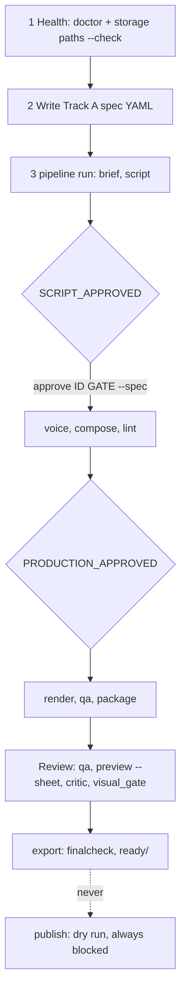

# User journeys (Phase 2, 2026-10-19)

Evidence base: source reading only (cli.py, pipeline.py, core.py, queue.py, storage_cli.py, dashboard.py). No command was executed; "Existing tests" names files by filename and is NOT a coverage claim (Phase 4 inspects assertions). Journeys the code does not support are in the last section, not mixed in.

Primary users per the owner's notes: one owner-operator who also directs agents. Typical session: agent builds, owner reviews at two gates, owner approves export. So the UI is mainly for a creator/reviewer with operator and debugging needs.

## J1 Discover prerequisites and diagnose the environment
- Goal: know what is installed and which provider is selected per capability.
- Commands: `./contentos.sh doctor` (cmd_doctor; exit 1 if any capability has no selected provider); `./contentos.sh storage paths --check` (creates and test-writes workspace and publishing roots).
- Output: text lines `PASS | OPTIONAL | NOT_INSTALLED` per candidate, with a `fix:` hint from `FIX`. Dashboard already shows provider health from `providers.candidates` (cached 60 s).
- Failure modes: missing Homebrew ffmpeg, missing Kokoro/whisper, unwritable workspace, in-repo workspace refused.
- Tests: test_storage.py, test_hf.py, test_renderers.py (names only).
- Gap: doctor output is human text; a structured form exists internally (`providers.candidates`) and should be exposed. Proposed UI: Health screen with per-capability rows, fix hints, re-check button (read-only).

## J2 Create a video job
- Supported inputs: a Track A spec YAML (content_id, title, format, voice, script lines; features opt-in block from Milestone 2), written by hand or by an agent following docs/AGENT_BRIEF.md section 4. A Track B folder is registered with `job register PATH --track B`. ContentForge v1 contract is parked.
- No `create` or `validate` command exists. Closest checks: script lint in the `script` stage (`script-lint.json`) and `director check`/`direction validate` for plans. `content_id` must pass `storage.valid_job_id`; gates are keyed by content_id; digests bind approvals to script and production state (commit b3dabdb).
- Proposed UI: wizard that writes a spec file to the workspace (never the repo) and runs a dry validation. Needs a backend `validate_spec` that reuses existing lint and schema logic. NOT existing: flagged in the gap list.

## J3 Configure track, template, voice, assets, rendering
- Real options in code: `format` (9:16, 16:9), `voice` (Kokoro ids), `render` (hyperframes default, remotion, mpt), `--allow-paid` (off by default; UI must keep it off), feature flags under `features:`. Styles in `config/styles`, design library in `config/design-library.json` (76 tagged options) and `intelligence.designs recommend`.
- Proposed UI: only expose options that exist; show the default and which are experimental.

## J4 Validate before execution
- Existing partial validation: script lint, `production/direction.py validate`, `director.py check`, digest binding at approve time. No single "validate this spec" entry point (gap).

## J5 Execute one job
- `./contentos.sh pipeline run SPEC [--force] [--only STAGE] [--approve-private]` runs stages in order, stops BLOCKED at gates; one `.run.lock` per job (second run refused). `./contentos.sh production run SPEC` wraps it with retries (transient stages voice/compose/render, 15 s and 45 s backoff, 360 s cap) and prints one JSON line `{ok, failureClass, stage, error, attempts, elapsedS}`.
- Resume: by artifact existence; core.scrub_interrupted removes unfinished artifacts but runs before the lock (known issue). A changed spec under the same content_id can reuse stale audio/video unless `--force` or a new id.
- State transitions: stage rows in ledger `runs`; job-level status in manifest (`created`, ... validated by `JOB_STATUSES`).
- Proposed UI: Run button that calls the production core, not a new state machine.

## J6 Batch production
- `queue add SPEC... [--approve-private --priority N]`, `queue list`, `queue requeue ID`, `worker [--concurrency 2] [--once]`. Jobs are ledger rows; each runs `pipeline run` in a subprocess; BLOCKED parks as `blocked`. Duplicate content_id queued/running is skipped. Concurrency default 2; per discovery notes nothing has ever run concurrently, the queue has no timeout, retry or cancel. Owner decision: quality first at concurrency 1.
- Proposed UI: queue table limited to add/list/requeue with concurrency fixed at 1 until measured.

## J7 Observe progress and stage status
- Today: dashboard polls `/api/state` (job list, stages with status OK/DONE/RUNNING/FAIL/BLOCKED/STALE/PENDING, seconds, provider, error). STALE is derived when RUNNING > 600 s. No push channel. `status` CLI prints the last ledger rows.

## J8 Logs and failure diagnosis
- Stage errors are stored in ledger `error` (truncated by callers; production core caps at 600 chars). Core writes progress to stderr. No persistent per-job log file was found in pipeline.py or core.py (search for `.log` found none; subprocess output is piped). This is a significant UI gap: the logs screen needs the backend to capture per-stage stdout/stderr, or must be limited to ledger errors for now.

## J9 Retry, resume, cancel
- Retry: automatic for transient stages inside production core; manual re-run of `pipeline run` resumes; `queue requeue` for failed/blocked jobs; `--force` re-runs stages.
- Cancel: NO command exists. The queue has pid tracking and `recover()` requeues dead-worker jobs; no kill path. UI must not show Cancel until one exists.

## J10 Preview and inspect artifacts
- `preview TARGET --at t1,t2 --out DIR [--sheet --cols N]` (pre-render from project dir, post-render from MP4). Dashboard serves video.mp4, qa.json, script.md, metadata.yaml, publish-result.json, script-lint.json. Artifact layout: `workspace/jobs/YYYY/MM/DD/<id>/` (audio, project, video.mp4, qa.json, content.json, manifest).

## J11 Review quality gates
- In pipeline: nine `run_qa` checks (WARN-only: loudness, frozen frames) plus export `finalcheck`. Standalone: visual_gate (captions, transitions, safezone, layers, log), Rule A/B, critic validation, cue audibility. Milestone 1 recorded known gaps in these gates; UI must show gate provenance (in-pipeline vs manual) and thresholds' provisional status.

## J12 Approve or reject
- `approve CONTENT_ID GATE [--note] [--spec]`; digest-bound for SCRIPT and PRODUCTION; unbound with warning if no spec found. No reject command. PUBLISH_APPROVED can be recorded but publish remains disabled. UI actions: approve SCRIPT/PRODUCTION after showing script and composed project; Reject = a UI-only note unless a backend reject is added (proposal, labelled future).

## J13 Diagnose interrupted jobs and bad configuration
- `storage recover` (dry run unless `--apply`), `storage cleanup` (dry run unless `--apply`; deletes), `storage inventory`, `storage ready [--check]` (integrity), `queue` recover on worker start.

## J14 Export (exists, beyond the owner's 13)
- `storage export JOB [--force] [--mode]` validates then copies to the publishing library `ready/`; needs both gates; supplied-audio rights blockers apply.

## Future, NOT supported today (do not build as if they exist)
Spec validation endpoint; per-job logs; cancel; reject; real publishing; structured doctor output; concurrent execution evidence.
