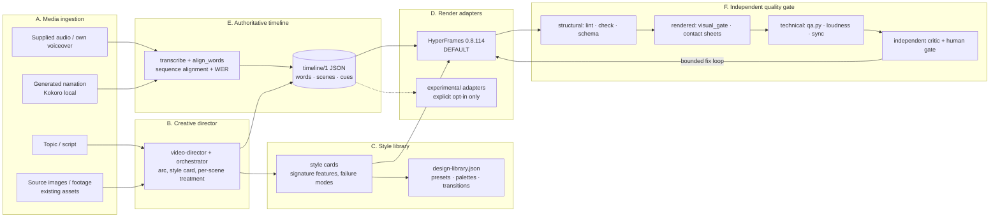
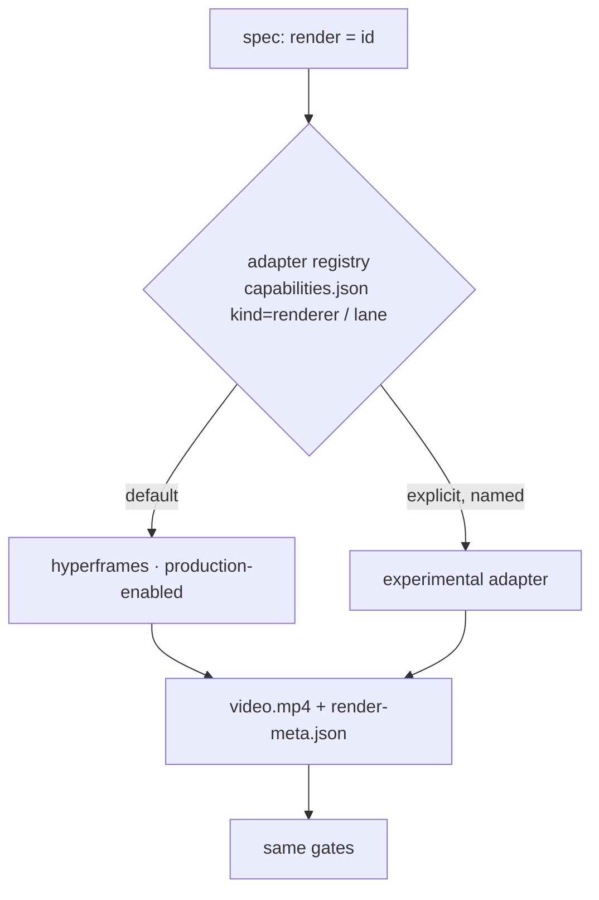
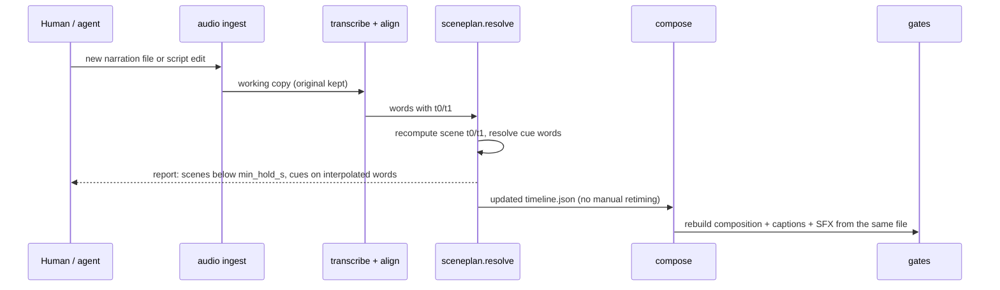

# 06 — Video Factory target architecture

Date: 2026-10-11 · Branch audited: `video-intelligence` @ `422751d5db0bd6c77407920893cb44112ac3a80f` · Status: **proposal — nothing here is implemented, tested or approved.**

Companion reports: `05-external-repository-audit.md` (evidence on the seven upstream repos) and `07-prioritized-integration-roadmap.md` (gap matrix, experiments, phases).

Labels: **[read]** I read the file in the checkout · **[doc]** stated by an existing report/note, not re-checked by me · **[mine]** my proposal · **[unverified]** not checked.

## 1. The answer in one paragraph

The factory already has the hard parts: gated stages, a pinned deterministic renderer, a word-anchored scene plan, an independent critic with a computed verdict, ffprobe/ffmpeg QA, and a rendered-frame visual gate. What it lacks is not another engine but **five small, project-owned pieces**: (1) one authoritative per-job **timeline** that captions, cues, review and QA all read; (2) a **supplied-audio** ingest path; (3) **versioned style cards** with checkable signature features; (4) **timeline-labelled contact sheets** and a style-aware review checklist; (5) an optional **procedural SFX/mix** module. Plus one correctness fix that needs no upstream code: Track A still maps captions to ASR words with a proportional index (see §2.2). HyperFrames stays the default renderer; no second renderer is added.

## 2. Current architecture (verified)

### 2.1 What exists

| Area | Where [read] | State |
|---|---|---|
| Pipeline stages `brief > script > voice > compose > render > qa > package > export > publish` | `contentos/pipeline.py` (`STAGES`, `FN`) | **Implemented.** Resume by artifact; `SCRIPT_APPROVED` before voice, `PRODUCTION_APPROVED` before render; publish is DRY_RUN and refuses without `PUBLISH_APPROVED`; transient retry/failure classes in `production/core.py` |
| Renderer | `contentos/hf.py` → `node_modules/.bin/hyperframes` (pinned **0.8.114**, `config/capabilities.json`) | **Default.** `RENDER_LANES = ("hyperframes","mpt")`; `mpt` is an alternative lane for stock-footage videos |
| Voice, ASR | `s_voice` (Kokoro via `hyperframes tts`, `loudnorm` to −14 LUFS); `words_for` (whisper.cpp via `hyperframes transcribe`) | **Implemented**, English-only model installed [doc: `docs/factory-v2`] |
| Scene plan | `production/sceneplan.py` (`sceneplan/1`, scenes anchored to **narration words**, `resolve()` → `t0/t1`) | **Implemented, Track B only** |
| Word alignment | `production/align.py` (`align_words`: difflib sequence match + WER, interpolates unmatched words) | **Implemented; used by `sceneplan.py` only** |
| Direction validation | `production/direction.py` (548 lines, rejects unknown fields), `director.py`, `platforms.py` (length/aspect limits) | **Implemented**; read-only validators |
| Capability registry | `config/capabilities.json` — 93 entries: 48 rules, 22 blueprints, 6 house rules, 6 tools, 5 skills, 2 treatments, renderer, native, lane, ref; statuses 88 installed / 2 available / 1 candidate / 2 unavailable | **Implemented** |
| Design library | `config/design-library.json` — 76 entries (13 frame presets, 9 palettes, 8 visual styles, 14 shader and 32 CSS transitions); separate *available / validated (per named environment) / recommended* [doc: `04-visual-reliability-gate.md` §8] | **Implemented**; validated in cloud: 2 CSS transitions; shaders failed in cloud, **0 validated on Mac** |
| Catalogue | `contentos/intelligence/catalogue.py`, `config/motion-catalogue.json` (70 techniques, all `unverified`) | **Implemented** |
| Background rules A/B | `contentos/intelligence/visual.py` | **Implemented**; Rule B decision (duration-dominant backdrop) committed in `422751d` [doc] |
| Technical QA | `contentos/qa.py` — resolution, fps, duration, audio track, `ebur128` loudness & true peak, `blackdetect`, `freezedetect`; thresholds in `config/quality.yaml` | **Implemented** |
| Rendered-frame gate | `production/visual_gate.py` — transition verdicts (blend / hard-cut / black), render-log scan, caption ink check, caption layer order | **Implemented**, thresholds calibrated on fixtures and ep3 only [doc] |
| Motion audit | `production/motion_audit.py` — easing inventory, `ydif` pops, still fraction | **Implemented** |
| Independent critic | `production/critic.py` — 8 scored dimensions, 7 named hard failures, **verdict computed from scores**, thresholds `7 each / 8.0 avg` marked *provisional* | **Implemented** |
| Preview / contact sheet | `production/preview.py` — `snapshot`, `video_frames`, `contact_sheet` (uniform grid of caller-chosen times, no labels) | **Implemented, basic** |
| Skills | `.claude/skills/`: `video-director`, `video-production-orchestrator`, `explainer-motion-craft` (R1–R6), `explainer-visual-qa`, pinned upstream `hyperframes-core / -animation / -keyframes` | **Implemented** |
| Experimental motion | p5.brush hand-drawn treatment (`treatment:handdrawn-p5brush`, status `candidate`) | **Partial** — verdict KEEP EXPERIMENTAL; human A/B pending [doc: `docs/factory-v2/09`] |

### 2.2 What is partial

- **Caption timing is not unified.** Track A's `s_compose` computes each word's time with a proportional index into the ASR words: `asr[min(int(k * n / len(toks)), n - 1)]` (`pipeline.py:150`) [read]. `align.py`'s own docstring says a proportional map is what it replaces ("an ASR insertion/deletion shifts only the words around it instead of every later caption"), yet only Track B's `sceneplan.py` imports it [read: grep]. So when the ASR word count differs from the script's, every later Track A caption can drift. **Verified by reading; the size of the drift on real audio was not measured.**
- **Track B has no builder.** No code turns a `direction` plan into HyperFrames HTML; compositions are agent-authored and `pipeline.compose` does not read `direction` [doc: `docs/research/jev/current-architecture.md` §3, consistent with my grep].
- **Safe zones:** rule R5 is guidance only; 9:16 platform-UI overlap zones are explicitly "NOT verified" [read: `explainer-motion-craft`].
- **Shader transitions:** untested on the Mac; the cloud finding is hard cuts or black textures. The Mac harness exists (`docs/video-intelligence/mac-experiment/`) but its results have not come back [doc].
- **Critic calibration:** thresholds provisional; the unchanged ep3 baseline scored up to 2 points apart between rounds [doc: `03-design-library.md`].
- **Known failing test:** `tests/test_core.py::test_local_beats_paid_even_when_both_healthy` (`'paid_api' != 'paid_api'`), pre-existing, unrelated; last recorded suite 363 passed / 1 failed / 2 skipped [doc: `04-visual-reliability-gate.md` §5 and the Project note]. **I did not re-run the suite in this audit** (the device shell is a Linux VM and the audit did not require it); this failure must be preserved, not fixed, by any change in the roadmap.

### 2.3 What is absent (verified by search)

| Absent capability | Evidence |
|---|---|
| **Supplied audio / MP3 / original voiceover** as pipeline input | No `audio`/`mp3`/"supplied" handling in `pipeline.py`, `cli.py`, `production/*.py`, `handoff.py`; `s_voice` accepts only Kokoro (`prim["id"] != "kokoro_local"` → Blocked) [read: grep] |
| **Music, SFX, ducking** | The only `bgm` reference is `--bgm-type=none` in `mpt.py` ("bundled tracks have no verified licence") [read: grep] |
| **One authoritative timeline file** | Track A keeps per-line durations inside `s_compose`; Track B has `scene-plan.resolved.json`; neither is read by captions, QA and review together [read] |
| **Timeline-labelled review sheets** | `contact_sheet()` tiles a list with no timestamps and no beat source [read] |
| **Audio–visual sync check** (visual cue vs spoken word / SFX onset) | No such check in `qa.py`, `visual_gate.py`, `critic.py` (the critic's `av_sync` is a human/LLM score) [read] |
| **Style fidelity** | Critic dimensions have no `style_fidelity`; no per-style failure modes in the design library [read] |
| **Voice cloning** | Not present; Kokoro only. **Not available and must not be implied.** |
| **Thumbnail generation** | A manual brief only [doc: `00-plan.md` decision 5] |
| **Documentary evidence provenance** | The critic has a `claim_unverified` hard failure but there is no structured source record [read] |

## 3. Target architecture



The only new boxes relative to today are the **timeline JSON**, the **supplied-audio branch**, the **style cards**, the **labelled sheet** inside G2, and an optional **SFX** writer that reads the timeline. Everything else is an existing module.

### 3.1 Design rules

1. **One source of truth per fact.** Time lives in `timeline/1`. Style lives in a style card. Capability status lives in `capabilities.json`. Neither is duplicated into prompts.
2. **Anchor to words, not seconds.** Cues name a word (plus an offset); absolute seconds are only for things not tied to narration (music beds, tail holds).
3. **A renderer is an adapter, not a rewrite.** Same timeline in, `video.mp4` + `render-meta.json` out.
4. **Measure before you claim.** A style, adapter or timing method is `recommended` for fit but `validated` only after the required checks pass in a *named environment* — the separation the design library already enforces.
5. **Gates fail closed; creative judgement stays human.** Objective failures stop the run; style quality needs a reviewer who did not build it.
6. **Local-first, opt-in, cost-visible.** Paid providers stay blocked by default (`local-first-policy.yaml`, `providers.select`) [doc]; any paid or data-exporting step prints what leaves the machine and what it costs before it runs.

## 4. Interfaces

### A. Media ingestion

| Input | Path through the factory | New work |
|---|---|---|
| Topic / script | brief → script → `SCRIPT_APPROVED` (unchanged) | none |
| Generated narration | Kokoro (`s_voice`) → transcribe → align | none (feeds the timeline) |
| **Supplied MP3 / voiceover** | `audio: {file, rights}` in the spec → copy as `source.<ext>` (never modified) → ffprobe → normalised **working copy** → transcribe → align to script (or, with no script, the ASR text becomes a draft that a human approves as `SCRIPT_APPROVED`) | **New**: spec field, ingest function, rights record |
| Original voiceover | same as supplied audio | same |
| Source image / product image | existing asset path; recorded with a rights status | rights field only |
| Source footage / reference video | **extension point only** — see §7 | none now |
| Existing visual/audio assets | listed in the job manifest with `source`, `licence`, `rights_status` | manifest fields |

Supplied-audio contract [mine]:

```json
{
  "audio": {
    "source": "supplied",
    "file": "voiceover.mp3",
    "sha256": "<computed at ingest>",
    "rights": { "status": "owned | licensed | unknown", "evidence": "free text or path" },
    "keep_original": true
  }
}
```

`unknown` rights do **not** block rendering a private draft but **do** block `PUBLISH_APPROVED`. Supplied audio is never re-synthesised and never silently changed; loudness is normalised on a copy.

### B. Creative director

Inputs: content type, audience, intended emotion, available assets, aspect, runtime budget (from `platforms.py`), render budget, evidence-backed capability status (from `capabilities.json` + design library `validated` per environment).

Outputs (extends the existing `direction`/`sceneplan` fields; additive, behind a version bump so `direction.py` — which rejects unknown fields — stays authoritative) [mine]:

- `style`: a style-card id (§C) or `none` (use presets as today).
- Per scene: `treatment` ∈ {`diagram`, `data_viz`, `ui_recreation`, `typography`, `collage`, `image_led`, `source_footage`, `code_graphics`}, `visual_intent`, `focal_point`, `reveal` (word anchor + offset), `readability_hold_s`, `transition`, `audio_cue` (optional), `fallback` (a capability id that is `installed`).

Rule: a treatment is **selectable only if its capability is `installed` or the style card marks it validated in the named environment**; otherwise the director must pick the declared fallback. This is the same substitution logic as `director.select_capability()` [read]. Do not add treatments to `capabilities.json` without a smoke test ("Never edit `capabilities.json` to make a technique look available" [read: orchestrator skill]).

### C. Style library

One versioned card per style, stored as data next to `config/design-library.json` (not inside it, so the library's schema stays stable) [mine]:

```json
{
  "schema": "style/1", "id": "editorial-collage", "version": 1,
  "emotional_intent": "curious, tactile, human",
  "motion_personality": "stepped, slightly imperfect; no overshoot",
  "use_when": ["history/culture explainers", "opinion with a point of view"],
  "avoid_when": ["precise data tables", "code walkthroughs", "legal or medical claims"],
  "base": { "preset": "preset:biennale-yellow", "palette": null, "fonts": ["vendored in assets/"] },
  "signature_features": [
    { "id": "paper-ground", "check": "human", "how": "visible paper grain on every scene background" },
    { "id": "stepped-motion", "check": "gate", "how": "motion on a 12 fps grid; >=80% of moving elements" },
    { "id": "scissor-edge",  "check": "human", "how": "2-4 px light edge on cut-outs" }
  ],
  "failure_modes": ["looks like a template (generic_template_look)", "halftone moire on phone", "captions lost under paper layers (KF-005)"],
  "engine_compat": { "hyperframes@0.8.114": { "status": "unverified", "validated_in": [] } },
  "licensing": { "fonts": [], "assets": [], "notes": "procedural shapes only; no third-party imagery" },
  "samples": { "prompt": "docs/video-intelligence/styles/editorial-collage.prompt.md", "renders": [] },
  "evidence_required": ["hyperframes_check", "captions_visible", "rule_b_distinct", "reviewed_by_human"]
}
```

Provenance rule: a card may cite an upstream *idea* (for example, mg-styles-15's signature-feature format) but contains **our** wording and parameters; it never embeds an upstream prompt verbatim or a third-party asset. `status` is `unverified` until the evidence list is satisfied, exactly like library entries today.

### D. Render adapters



Adapter contract [mine]:

```json
{
  "id": "hyperframes", "status": "production", "pin": "0.8.114",
  "validated_in": ["mac-hf0.8.114"],
  "capabilities": { "aspects": ["16:9","9:16"], "audio_in_render": true, "seek_deterministic": true,
                    "transitions": ["css"], "shader_transitions": "unverified" },
  "inputs": ["composition_dir", "timeline.json"],
  "outputs": ["video.mp4", "render-meta.json"],
  "render_meta": ["renderer", "version", "command", "seconds", "peak_rss_mb", "log_codes", "environment"],
  "error_classes": ["blocked", "transient", "output"],
  "fallbacks": ["css-transition:push-slide", "css-transition:blur-crossfade"]
}
```

- **Production-enabled:** HyperFrames only. A shader transition request falls back to a validated CSS transition and **records** the substitution (the substitution logic exists in `director.select_capability()`; wiring it into render is a pipeline change not yet made [doc: `04-visual-reliability-gate.md` §4]).
- **Experimental:** the `mpt` lane (stock footage) already follows this pattern. A new adapter enters as `candidate`, runs only when a spec names it, and may not be chosen by the director.
- **Admission test for any new adapter [mine]:** a named use case that HyperFrames cannot render acceptably, shown by a measured failure — not a preference. **Today no such use case exists** (see 05 §8 and 07 §5).

### E. Authoritative timeline

One file per job — `timeline.json`, schema `timeline/1` [mine] — derived once and read by captions, cues, sheets, SFX and QA:

```json
{
  "schema": "timeline/1", "job": "<content_id>", "fps": 30, "duration_s": 42.7,
  "audio": { "source": "supplied|generated", "sha256": "…", "rights": { "status": "owned" } },
  "alignment": {
    "method": "sequence-match", "match_ratio": 0.97, "wer": 0.03,
    "timing_trust": "asr-derived-unverified",
    "verified_anchors": []
  },
  "words": [ { "i": 0, "text": "Most", "t0": 0.42, "t1": 0.61, "source": "matched|interpolated" } ],
  "scenes": [ { "id": "s1", "starts_at": 0, "t0": 0.0, "t1": 7.8, "min_hold_s": 2.0 } ],
  "cues": [
    { "id": "c-hook", "kind": "visual", "scene": "s1", "at": { "word": 3, "offset_s": -0.05 } },
    { "id": "c-hit",  "kind": "sfx",    "scene": "s1", "at": { "word": 9, "offset_s": 0.0 }, "sound": "pop" },
    { "id": "c-bed",  "kind": "music",  "at": { "t": 0.0 }, "duck_under_voice_db": -9 }
  ]
}
```

**How it is built.** `transcribe` → `align_words` (already written) → `sceneplan.resolve()` (already written) → cues resolved from word anchors. Nothing new is invented except the container and the cue resolver.

**Word timing is not assumed accurate.** `match_ratio` and `wer` measure *consistency between script and ASR*, not timing error. `timing_trust` therefore stays `asr-derived-unverified` until a human-marked anchor set (Experiment E1) measures the error on that environment; only then may it read `verified (median X ms, p95 Y ms, n anchors)`. Words with no ASR counterpart are marked `interpolated`, and cues anchored to an interpolated word are flagged.

**Propagation when narration changes** (new take, different speed, supplied replacement):



- A scene shorter than its `min_hold_s` is **reported, not silently squeezed**; the fix is to trim words or lengthen the scene (the factory's own pacing note: a 3.0 words/s script is too dense; guidance 2.3–2.5 words/s [read: `explainer-motion-craft` R6]).
- Edits that change word *order* require a script change and re-approval of `SCRIPT_APPROVED`; pure re-timing does not.
- Anything derived (captions, cue sheet, contact-sheet times, SFX, QA windows) is regenerated, never hand-edited. "Retiming = editing the timeline, then regenerating" is the pattern in `whaleyxbt/claude-motion` (`AGENTS.md`) [read, see 05 §6].

### F. Independent quality gate

Layers run in order; the first hard failure stops the run:

| Layer | Checks | Exists? |
|---|---|---|
| Structural | `hyperframes lint` + `check` (incl. WCAG contrast), schema validators (`direction`, `timeline/1`, style card), `align` stats (match ratio, WER) | mostly yes; `timeline/1` and style-card validators new |
| Rendered frames | `visual_gate` (transitions blend/hard-cut/black, caption ink, caption layer order, render-log fallback codes); **timeline-labelled contact sheet** with a settle offset and scrub strips around every cut; black-frame and pop scan (`motion_audit`) | gate yes; labelled sheet **new** |
| Layout | title-safe / action-safe boxes, clipping, font availability, contrast; **9:16 platform-UI zones remain unverified until measured on a phone** | partial; safe-zone check new, small |
| Technical | duration, codec, aspect, audio tracks, loudness (`ebur128`), true peak, and — new — **cue-vs-onset offset** for supplied/SFX audio read from the timeline | `qa.py` yes; sync check **new** |
| Independent review | `critic.py` with a style-conditional `style_fidelity` dimension; reviewer ≠ builder; three runs on any high-stakes cut, spread reported | critic yes; dimension new |
| Human gates | `SCRIPT_APPROVED` (before voice), **style / look pick** (new, optional), `PRODUCTION_APPROVED` (before render), `PUBLISH_APPROVED` | two exist; look pick new |

**Bounded fix-and-review loop** [mine]: at most **3 rounds**. Each round: reviewer lists faults with timecodes; builder fixes; **an objective gate or a measured frame comparison must confirm each fix** — a critic saying "fixed" does not count (`claude-motion`'s rule "don't claim a fix you haven't re-rendered and looked at" is the same idea). After round 3 the job stops for a human decision. Critic score noise (up to ±2 between rounds on an unchanged video [doc]) means scores are direction, never proof.

### G. Future extension points (interfaces only; **nothing here is built or implied available**)

| Extension | Interface reserved now | Gate before it can be used |
|---|---|---|
| Documentary research and evidence provenance | `sources[]` in the brief: `{url, retrieved, licence, claim_ids}`; critic `claim_unverified` already blocks | owner approval of sourcing rules |
| Video/image asset selection | asset manifest with `source`, `licence`, `rights_status`, `hash` | rights status ≠ `unknown` for publish |
| Optional image/video generation | provider adapter registered `paid:true`, cost estimate printed before the call, behind `allow_paid` | explicit owner enable; data-egress notice |
| Original voiceover + transcription | **covered by §A/E (supplied audio)** | rights record |
| **Optional voice cloning** | none yet — **not available**; see §7 for the policy that must exist first | documented consent, access control, voice-ID policy, tested provider |
| Thumbnail and packaging | `thumbnail_brief` stays manual; later an adapter that reads the timeline for the hook frame | none now |
| Landscape ↔ portrait re-composition | same plan and timeline, per-aspect layout (already the model: "the 16:9 and 9:16 builders only differ in layout" [read: `sceneplan.py`]) | per-aspect safe-zone check |

## 5. Dependencies and cost

| Component | New dependency | Runtime | Cost |
|---|---|---|---|
| timeline schema + loader | none (stdlib `json`) | negligible | $0 |
| supplied-audio ingest | none (`ffprobe`/`ffmpeg`, whisper.cpp already present) | one transcribe pass | $0 |
| labelled contact sheet | none (ffmpeg `drawtext`, already used) | seconds | $0 |
| style cards | none (data) | none | $0 |
| optional SFX/mix | none (Python stdlib; MIT-licensed upstream module adapted) | pure-Python per-sample loops — **measure** a 60 s mix before adopting [unverified] | $0 |
| second renderer | — **not proposed** | — | — |

Per-video external cost today and under this plan: **$0** (all local). Any optional paid step must print `cost ≈ units × price` with the missing inputs named before running.

## 6. Failure handling and determinism

- Every adapter returns `blocked | transient | output` using the existing `production/core.classify()` [read]. Transient retries stay limited to voice/compose/render with the existing back-off (15 s, 45 s, 360 s cap) [doc].
- Reproducibility: HyperFrames re-renders of the same project were bit-identical in the p5.brush A/B (288/288 frames) [doc]; the sampler experiment records one environment per result. A result is never carried across environments (cloud vs Mac) without a re-run — the library's `validated_in` field enforces this.
- Experimental output lives in `<workspace>/experiments/<id>/` (git-ignored) and never in publishing or source-control paths; no large video is copied into either.

## 7. Rights, consent and data egress

- **Source-media rights.** Being able to ingest or transform a video does not grant permission to reuse its footage, voice or music. Every supplied or sourced asset carries `rights_status` (`owned | licensed | unknown`) and evidence; `unknown` blocks publish. No tool that "remakes" third-party videos (see 05 §2) is adopted.
- **Data leaving the machine.** Default pipeline: none. Any adapter that uploads voice, footage, images or script text must declare `data_egress` (what, to whom, retention if known) and require an explicit opt-in per run. Uploading a **voice sample** is treated as the most sensitive case.
- **Voice cloning — policy that must exist before any engine is integrated** [mine]:
  1. Written consent from the voice's owner, naming the use, scope and duration, stored with the job and revocable.
  2. Only the owner's own voice by default; no imitation of any real person without that person's authorisation.
  3. Access control: who may create, use and delete a voice ID; voice samples stored only in an access-restricted folder, never in the repo or the publishing library.
  4. A retention and deletion rule for samples and resulting voice IDs, including provider-side deletion where supported.
  5. Provider and licence reviewed for commercial use; disclosure rule for synthetic voice on each platform.
  6. A tested provider/engine, with a recorded smoke test, before the factory states the capability exists.
  Until all six hold, the interface is **not built** and documentation must say "not available".
- **Fonts and assets.** Vendor fonts into `assets/` with their licence recorded on the style card; never rely on web fonts at render time (design-library rule 4, [read]).

## 8. Explicit non-goals

- No second renderer, no Remotion adapter, no `renderAt(t)` harness imported.
- No prompt-to-code generation inside a user-facing app; no runtime `eval` of model output (05 §4).
- No generative image/video pipeline, no MuAPI, no paid provider enabled by default.
- No voice cloning, face-preserving restyling, or "remake this video" feature.
- No music-driven beat engine until a music-led video is actually requested.
- No change to production rendering defaults, renderer adapters, ContentOS contracts, global skills or installed dependencies as part of the audit; every item above is a proposal awaiting approval.
- No copying of upstream repositories or prompts wholesale; only small techniques, rewritten and recorded with attribution where MIT requires it.
- No claim that any proposed style, timing method or adapter works until the named environment has produced evidence.

## 9. Current → target, at a glance

| | Current | Target |
|---|---|---|
| Caption timing | proportional index (Track A) / sequence alignment (Track B) | one method, `align_words`, everywhere |
| Time source | per-line durations in `s_compose`; `scene-plan.resolved.json` | one `timeline/1` per job |
| Audio in | Kokoro per script line | + supplied audio with rights record |
| Audio out | narration only | + optional procedural SFX/bed, ducked, from the timeline |
| Style | presets/palettes + CSS transitions | + versioned style cards with checkable signature features |
| Review | uniform contact sheet + critic | + timeline-labelled sheets, `style_fidelity`, bounded fix loop with objective confirmation |
| Renderer | HyperFrames 0.8.114 (+ `mpt` lane) | unchanged; adapter contract written down |
| Voice | Kokoro | unchanged; cloning stays *not available* |
