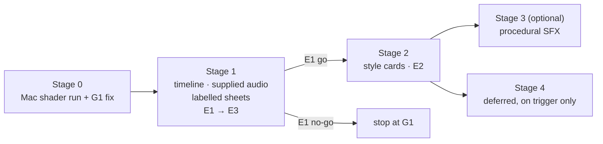

# 07 — Prioritized integration roadmap

Audit date: **2026-10-11**. Status: **proposal only**. Nothing here is implemented, tested or approved. Evidence labels as in `05-external-repository-audit.md` §0: **[read]** I read it, **[claim]** upstream says so, **[not verified]**, **[mine]** my recommendation.

Companion reports: `05-external-repository-audit.md` (what the seven repos really contain), `06-video-factory-target-architecture.md` (target design and interfaces).

---

## 1. Executive answer

**Smallest set of changes that most improves visual quality, creative range and reliability, while keeping the working pipeline:**

| # | Change | Why it earns its place | Size |
|---|---|---|---|
| 1 | **P0 fix: Track A captions use `align_words`** instead of the proportional index at `contentos/pipeline.py:150` [read] | A correctness bug in the shipping path. Fixes drift without any new dependency. `production/align.py` already exists and is used by `sceneplan.py` [read] | S |
| 2 | **`timeline/1`**: one JSON file per job that scenes, captions, cues and QA all read | Today timing lives in per-line durations and `scene-plan.resolved.json`; nothing is authoritative. Pattern adapted from `claude-motion` `timeline.json` (MIT) | M |
| 3 | **Supplied-audio ingest with a rights record** | Unlocks "my own voiceover / MP3" without regenerating narration. `s_voice` is Kokoro-only [read] | M |
| 4 | **Timeline-labelled contact sheets** (+ safe-zone check) | Lets an independent reviewer see *what is on screen at which cue*. `preview.py` makes only a basic sheet [read]. Adapted from `claude-motion` `sheet.mjs` (MIT) | S |
| 5 | **Three versioned `style/1` cards** and a conditional `style_fidelity` critic dimension | The main creative-range lever; the design library has presets, not style definitions with checkable signature features. Schema adapted from `mg-styles-15` (MIT) | M |
| 6 | **Optional procedural SFX** (only after 1–5) | Factory has no SFX/music/ducking [read]. Adapted from the `claude-motion` stdlib sound engine (MIT) | M |

**What I would not add:** a second renderer (Remotion), a prompt-to-code sandbox, generative image/video (vox/MuAPI), voice cloning, or source-footage "remake" tooling. HyperFrames 0.8.114 stays the default renderer.

**Owner action that costs nothing and unblocks the most:** run the already-designed Mac shader/transition experiment. Zero shader transitions are validated on the Mac (2 CSS transitions validated in cloud only) [doc: `docs/video-intelligence/03-design-library.md`]. Until that runs, much of the "creative range" in `design-library.json` is unverified, and no upstream repo can substitute for it.

---

## 2. Feature-gap matrix

Duplicate ideas are merged into shared project-owned capabilities (for example, "beat map", "cue sheet" and "sound placement" from three repos collapse into one `timeline/1`).

Size: S ≈ ≤1 day, M ≈ 2–4 days, L ≈ 1–2 weeks, XL ≈ more. These are [mine], rough, and assume familiarity with the code.

### 2.1 Active (recommended)

| ID | Capability | Existing implementation (path) | Proposed source (repo / path) | Missing problem it solves | Decision | Size | Runtime / dependency / cost | Reliability & licensing risk | Evidence required to prove value | Priority |
|---|---|---|---|---|---|---|---|---|---|---|
| G1 | Word alignment in Track A captions | `production/align.py::align_words` (used only in `sceneplan.py`); Track A uses proportional index at `pipeline.py:150` [read] | None — project's own code | Caption onset drift when ASR token count ≠ script token count | **Reuse own code** | S | None; $0 | Low. Changes caption timing in the shipping path → needs a regression test and a before/after on one existing job | Captions vs human-marked word onsets on one existing job: before/after error. Tests pass except the known failure | **P0** |
| G2 | Authoritative timeline | `scene-plan.resolved.json`, per-line durations in `s_compose` [read]. No single file | `claude-motion` `timeline.json` pattern (MIT) | Re-timing narration does not propagate; QA cannot check sync against one source | **Adapt** (pattern only; own schema `timeline/1`) | M | Stdlib JSON; $0 | Medium: touches compose. Mitigate by generating the timeline *beside* the old path first (shadow mode) | E1 | P1 |
| G3 | Supplied-audio ingest + rights record | `s_voice` Kokoro only [read]; whisper.cpp present | None (project-owned) | Cannot use own voiceover/MP3; no `rights_status` on any asset | **New build** (small) | M | ffprobe/ffmpeg/whisper.cpp already present; one transcribe pass; $0 | Rights: `unknown` must block publish. ASR word times are *unverified* — label them so | E1 | P1 |
| G4 | Timeline-labelled contact sheet | `production/preview.py` basic `contact_sheet` [read] | `claude-motion` `sheet.mjs` (MIT) | Reviewer cannot map frames to cues/words | **Adapt** | S | ffmpeg `drawtext` (already used); $0 | Low | E3 | P1 |
| G5 | Style cards + style-fidelity check | `config/design-library.json` (13 presets, 9 palettes, 8 visual styles) [read]; critic has 8 dimensions, no style dimension | `mg-styles-15` style/prompt/rubric structure (MIT) | "Looks like a template" (`generic_template_look`); no checkable signature features per style | **Adapt** schema + rubric; own wording | M | Data + one critic dimension; $0 | Never embed upstream prompts/assets verbatim. New dimension is *conditional* (only when a style card is selected) so existing thresholds are unchanged | E2 | P1 |
| G6 | 9:16 safe-zone / mobile-legibility check | `visual_gate.py`, `motion_audit.py` (captions-visible checks) [read]; no platform-UI safe zone check [read, grep] | None — own, using published platform guidance [not verified] | Captions/hooks hidden under platform UI in portrait | **New build** (small) | S | ffmpeg frame crops; $0 | Zone sizes differ by platform and change; keep them in config, mark `unverified` | Check flags a seeded fault in E3 | P1 |
| G7 | Procedural SFX + simple ducked bed | Only `--bgm-type=none` in `mpt.py`; `qa.py` measures loudness (ebur128) [read] | `claude-motion` stdlib sound engine (MIT, ~900 lines) | No audio design at all beyond narration | **Adapt**, behind a flag, after G2 | M | Pure-Python sample loops: **measure** a 60 s mix [not verified]; $0 | MIT attribution file. Audible quality unproven. Off by default | Blind A/B with/without SFX; no loudness regression in `qa.py` | P1 → P2 (conditional on E1 passing) |
| G8 | Independent review loop with seeded-fault verification | `critic.py` (8 dimensions, 7 hard failures, computed verdict) [read]; fix loop exists but "verified after rerender" is not proven [doc] | `claude-motion` self-review and `mg-styles-15` rubric (ideas) | Reviewer finds faults but nobody proves it finds *real* ones, or that fixes worked | **New build** (a harness, mostly process) | M | Existing tools; $0 | Critic scores vary run to run — report spread, do not treat as truth | E3 | P1 |
| G9 | Mac shader/transition validation | Experiment designed; 0 shaders validated on Mac [doc] | None | 14 shader transitions unverified; shaders fell back in cloud | **Run existing plan** | S (owner time) | Mac render time only | None new | The experiment's own result table | **P0** (owner action) |

### 2.2 Deferred or rejected (kept visible so they are not re-litigated)

| ID | Capability | Source | Decision | Why not now | Trigger to revisit |
|---|---|---|---|---|---|
| D1 | Beat/drop analysis for music-led videos | `claude-motion-design` audio scripts (MIT) | **Defer** | No music-led video has been requested; adds librosa-class dependency [claim/not verified] | A music-led video is on the production calendar |
| D2 | Subframe motion blur | `claude-motion-design` | **Defer / reference** | HyperFrames docs already describe it [doc]; no failure attributed to its absence | A reviewed render shows strobing on fast motion |
| D3 | Chunked parallel render | `claude-motion-design` | **Defer** | Render time is not the stated bottleneck; adds stitch-seam risk | Render time exceeds budget on real jobs |
| D4 | Remotion adapter | `remotion-dev/remotion` | **Defer** | License terms (free for individuals / ≤3-employee for-profits; `@remotion/transitions` package.json says `UNLICENSED`) need review before any company use [read]; no capability HyperFrames cannot meet | A specific treatment HyperFrames cannot render acceptably, plus legal review |
| D5 | Prompt-to-code sandbox | Remotion SaaS template | **Reject** | Its "sanitization" is cosmetic: it runs `new Function` on model output [read] | None; the factory validates plans, not model-written code |
| D6 | Generative image/video, paid-API pipeline | vox / MuAPI | **Reject for now** | No LICENSE file in the checkout [read]; paid per-call; not deterministic; clone-reference and watermark features | Explicit owner opt-in, cost formula, and a licence |
| D7 | Voice cloning | vox `clone_ref` (idea) | **Not built** | Needs the six-condition consent policy (06 §7) and a tested engine first | Policy approved + provider chosen + smoke test recorded |
| D8 | Source-footage transformation / "remake" | `claude-motion-design` remake flow | **Reject** | Rights: ability to ingest ≠ right to reuse | Rights status `owned`/`licensed` on the input, and a concrete use case |
| D9 | Physics/web sims | `claude-motion` | **Defer** | Large surface, no request | A topic needing simulation |
| D10 | UI-scale motion numbers | LottieFiles skill | **Reference only** | Timings are interactive-UI scale; the "Playful" overshoot conflicts with house rule R1 [read] | — |

---

## 3. Experiments (at most three)

Common rules for all three:

- **Isolation.** Work only in `<workspace>/experiments/<id>/` (git-ignored). Nothing is written to `docs/`, publishing paths or tracked source until a result is approved.
- **Environment named per result.** `mac-hf0.8.114` for anything that renders. Cloud results are not carried to the Mac (the library's `validated_in` rule).
- **Media policy.** Inputs are owner-owned. Outputs (mp4/png/wav) stay in the experiment folder. Only the small JSON/Markdown result table may be proposed for source control.
- **Cost.** Expected external cost $0 for all three. Each run logs wall-clock, peak RSS and any API calls (target: none). If a paid step appears, stop and report `cost ≈ units × price`.
- **Order.** E1 → E3 → E2. Never run two at once: they share the renderer and the Mac's memory.
- **Not yet done.** None of these has been run. Every threshold below is **provisional** [mine] and should be confirmed by the owner before the run.

### E1 — Shared timeline with supplied audio

**Hypothesis.** An aligned, authoritative timeline gives measurably better caption and cue timing than the current proportional mapping, and survives re-timing without hand edits.

| Item | Definition |
|---|---|
| Baseline | Current Track A path: Kokoro-independent captions via proportional index (`pipeline.py:150`) |
| Variant | G1 (`align_words`) + G2 (`timeline/1`) + G3 (supplied audio ingest), captions and 4–6 visual cues derived from the timeline |
| Fixed inputs | One 30–45 s owner-owned voiceover; one fixed script; 9:16, 30 fps; same style preset; same machine; same HyperFrames 0.8.114 |
| Perturbation | Re-time the audio by +12 % (and −12 %) and regenerate without editing scene files |
| Human anchors | Owner marks ~12 word onsets by ear/waveform (ground truth for timing). Without anchors, timing accuracy is **unmeasurable** — ASR is not ground truth |
| Expected outputs | `timeline.json`, `anchors.json`, `captions.baseline.json`, `captions.variant.json`, `labelled-sheet.png`, `result.md`, two short mp4s |
| Measurements | Caption onset error vs anchors (median, p95, ms); cue error in frames; manual edits needed after re-time; align match ratio and WER; render time; peak RSS; ffprobe duration and audio streams; `qa.py` loudness/blackdetect/freezedetect |
| Human review | Owner watches both renders on a phone: caption/voice sync feel, any cue that lands early/late, overall clarity |
| **Go** | Variant median ≤ 80 ms **and** p95 ≤ 160 ms; ≥ 90 % of cues within 2 frames; 0 manual edits after ±12 % re-time; baseline is ≥ 1.5× worse on median; no new `qa.py` failure |
| **No-go / partial** | If the baseline is already within thresholds, ship **only** G1 as a hygiene fix and drop G2/G3 as unneeded. If the variant misses thresholds, keep `timing_trust: "asr-derived-unverified"` and do not describe timing as accurate |
| Rollback | Delete `experiments/e1/`. No tracked file is changed by the experiment. Shadow mode means the old path is untouched |

### E3 — Contact sheet and independent review with seeded faults

**Hypothesis.** A timeline-labelled sheet plus an independent reviewer finds genuine visual faults, and fixes can be verified by objective gates after rerendering.

| Item | Definition |
|---|---|
| Baseline | Current review: `preview.py` basic sheet + critic as it runs today |
| Variant | G4 labelled sheet + G6 safe-zone check + a reviewer that has not seen how the video was made |
| Fixed inputs | The existing ep3 "variant E" with its known faults [doc], plus 4–6 faults seeded on a **copy** (for example: caption outside safe zone, clipped text, off-palette colour, 1-second black gap, scene shorter than its minimum hold, missing font fallback) |
| Expected outputs | `seeded-faults.json` (ground truth), `findings.baseline.json`, `findings.variant.json`, before/after sheets, `result.md` |
| Measurements | Recall of known + seeded faults; false positives per run; share of fixes confirmed by an *objective* gate rather than by the reviewer's say-so; critic score spread over ≥ 3 runs of the same video (report min/max, do not average away); review time |
| Human review | Owner marks each finding genuine / not genuine / unclear |
| **Go** | Recall ≥ 80 % **and** ≥ 20 points above baseline; ≤ 2 false positives per run; every accepted fix confirmed by an objective gate or labelled "human-verified only" |
| **No-go** | Recall gain < 20 points → keep the labelled sheet only if it costs ≤ S effort; drop the reviewer-loop change |
| Rollback | Seeded faults exist only on the copy; delete `experiments/e3/`. Original ep3 files untouched |

### E2 — Three-style bake-off

**Hypothesis.** Three distinct, card-defined styles can be produced on HyperFrames with the existing capabilities, are visibly different, and hold up on a phone — widening creative range without a new renderer.

Run **last**, serially, after E1 gives a shared timeline (so all three share one narration timeline) and E3 gives a trustworthy review process.

| Item | Definition |
|---|---|
| Styles (picked after reading the design library and the `mg-styles-15` preview frames) | **S1 Flat-vector technical** — base candidate `preset:cobalt-grid`. **S2 Editorial paper collage** — base candidate `preset:biennale-yellow`; procedural SVG paper/halftone texture, 12 fps stepped motion, no raster assets. **S3 Kinetic typography / line-art** — installed rules `kinetic-beat-slam`, `svg-path-draw`, `typewriter-reveal` |
| Baseline | The factory's current default look for the same script |
| Fixed inputs | Same 20–30 s narration, same beats, same approximate scene durations, same timeline (from E1); 9:16 and 16:9 if affordable; same machine and HyperFrames version |
| Expected outputs | Three `style/1` cards, three compositions, six short mp4s, labelled sheets, `result.md` with a score table |
| Measurements | Technical gates (`hyperframes check`, captions visible, backdrop signature, black/freeze); Rule B distinct treatments per scene vs baseline; render time and peak RSS per style; byte-identical or documented-difference rerender; critic scores over ≥ 3 runs (spread reported) |
| Human review (blind, owner ranks) | Story clarity · first-second hook · visual novelty without distraction · style fidelity (card's signature features) · focal hierarchy · phone readability · timed reveals · transition correctness · sync · ease of revision |
| **Per-style pass** | All technical gates pass; Rule B ≥ 2/5 better than baseline; render time ≤ 1.5× baseline; rerender reproducible; critic min ≥ 7 and avg ≥ 8 in ≥ 2 of 3 runs; owner ranks it as a style they would publish |
| **Go** | ≥ 2 of 3 styles pass → promote those cards to `validated_in: ["mac-hf0.8.114"]`. Failing styles stay `unverified` |
| **No-go** | < 2 pass → keep the cards as documentation, don't promote, and record the failure modes |
| Rollback | Delete `experiments/e2/`. No library entry changes until the owner approves promotion |

*Note.* Critic thresholds (7 each / 8.0 average) are the repo's own provisional values [read: `config/quality.yaml`]; scores are a noisy aid, not ground truth.

---

## 4. Staged phases

Each stage ends at a decision point. **No stage starts without approval.**

### Stage 0 — Correctness and facts (no new features)

1. Owner runs the existing Mac shader/transition experiment (G9).
2. G1: Track A uses `align_words`, with a regression test and a before/after on one existing job.
3. Re-run the test suite on the Mac; the known failure `tests/test_core.py::test_local_beats_paid_even_when_both_healthy` stays as-is (do not fix in this work).

*Exit:* shader status known; Track A timing no longer proportional.

### Stage 1 — Timeline, supplied audio, labelled sheets (E1, then E3)

1. G2 `timeline/1` in **shadow mode** (written, not yet read by compose).
2. G3 supplied-audio ingest with `rights_status`; `unknown` blocks publish.
3. G4 labelled contact sheet; G6 safe-zone check.
4. Run E1, then E3.

*Exit:* go/no-go from E1 and E3. If E1 is no-go, stop at G1.

### Stage 2 — Style cards (E2)

1. Write three `style/1` cards (own wording; attribution file for any MIT-derived schema element).
2. Add the conditional `style_fidelity` critic dimension.
3. Run E2; promote only passing styles.

*Exit:* ≥ 2 styles validated on the Mac.

### Stage 3 — Optional audio design (conditional)

Only if E1 passed and the owner wants SFX: adapt the procedural sound engine behind a flag, measure a 60 s mix, A/B test with the owner. Default stays "narration only".

### Stage 4 — Deferred items

Revisit D1–D10 only on their stated triggers. None is scheduled.

---

## 5. Licence, cost and consent

Full per-repo matrix: `05-external-repository-audit.md` §9. Summary for the active items:

| Item | Source & licence | Attribution / restriction | Paid service or API | Data leaves machine | Per-video cost |
|---|---|---|---|---|---|
| G1 | Own code | — | No | No | $0 |
| G2 | `claude-motion` (MIT) — pattern only; own schema | Keep a NOTICE line if any code is copied | No | No | $0 |
| G3 | Own code; whisper.cpp already in use | Rights record per asset | No | No | $0 |
| G4 | `claude-motion` `sheet.mjs` (MIT), rewritten | MIT notice if adapted code remains | No | No | $0 |
| G5 | `mg-styles-15` (MIT) — schema/rubric ideas | Don't copy prompts/assets verbatim; own wording | No | No | $0 |
| G6 | Own code | Platform safe-zone numbers marked `unverified` | No | No | $0 |
| G7 | `claude-motion` sound engine (MIT) | MIT notice; any bundled samples must be checked [not verified] | No | No | $0 |

Fonts: vendor into `assets/` with the licence recorded on the style card. Never rely on web fonts at render time.

**Cost formula for any future paid step:** `cost ≈ units × unit_price` per video; monthly `≈ videos/month × cost`. Missing inputs to name: provider, unit, price, retries. Today's plan has none.

**Consent and rights (unchanged from 06 §7):**
- Source-media rights: footage, voice and music need `owned` or `licensed` status before publishing.
- Voice cloning is **not available and not proposed for build**. It needs written consent, access control, retention/deletion rules, provider/licence review and a recorded smoke test first. Uploading a voice sample to a third party is the highest-risk data egress.
- No imitation of a real person without their authorisation.

---

## 6. What was and was not verified in this audit

| Verified (read) | Not done |
|---|---|
| Factory code paths cited above, by reading source at HEAD `422751d` | No tests were run (the device shell is a Linux VM that cannot run the Mac HyperFrames setup); the last recorded suite was 363 passed / 1 failed / 2 skipped [doc] |
| Seven upstream repos, statically, at pinned commits | No upstream code was executed, installed or rendered; no upstream video was watched |
| Licence files as present at the pins | `remotion-dev/skills` standalone licence not re-checked; vox has no LICENSE file in the checkout |
| — | No renders, no visual inspection of factory output, no caption-drift measurement on real audio (size of the G1 bug is **unmeasured**) |

---

## 7. Decision requested

Approve, change or decline:

1. **Stage 0** (G1 + owner's Mac shader run) — recommended first; smallest, no new dependency.
2. **Stage 1** (E1 then E3) — go/no-go thresholds in §3, to be confirmed by you.
3. Which three styles, if you want different ones from S1–S3.

I will not begin implementation until you approve.
